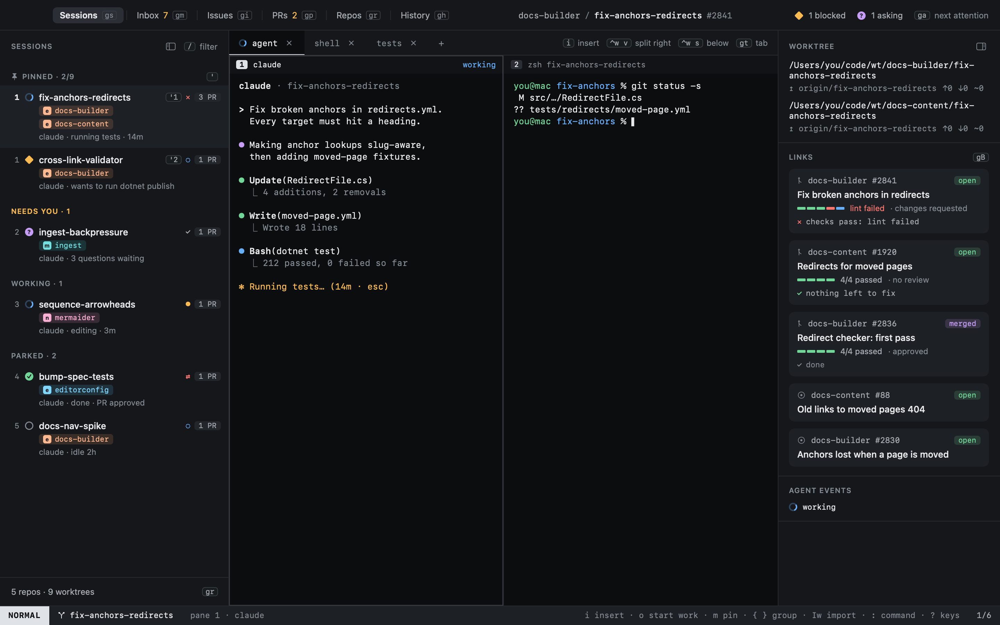

<p align="center">
  <picture>
    <source media="(prefers-color-scheme: dark)" srcset="design/brand/logo/owl-full-on-dark.svg">
    
  </picture>
</p>

<h1 align="center">heed</h1>

<p align="center"><strong>Run every agent. Ship every PR.</strong></p>

<p align="center">
  A native macOS app that feels like a TUI, with vim modes and keys, for running coding agents.<br>
  heed hosts Claude, Codex, Cursor, pi, opencode and gemini in real terminals, taps you only when one needs you,<br>
  then gets their pull requests green and merged.
</p>

<p align="center">
  <a href="https://github.com/heed-build/heed/releases/latest/download/Heed-arm64.dmg"><strong>Download for macOS</strong></a>
  ·
  <a href="https://heed.build">heed.build</a>
  ·
  <a href="https://heed.build/getting-started/">Docs</a>
  ·
  <a href="https://github.com/heed-build/heed/releases">Releases</a>
</p>

<p align="center">
  <a href="https://github.com/heed-build/heed/actions/workflows/ci.yml"></a>
  <a href="https://github.com/heed-build/heed/releases/latest"></a>
  
</p>



## Install

```sh
brew install --cask heed-build/tap/heed
```

Or [download the latest release](https://github.com/heed-build/heed/releases/latest/download/Heed-arm64.dmg)
(signed and notarized, Apple silicon), or `curl -fsSL https://heed.build/install.sh | sh`.

## What it does

- **Every agent, one window.** Claude, Codex, Cursor, pi, opencode, gemini or any command, each in a real libghostty
  terminal with tabs and splits. Agents report their state through hooks (working, idle, blocked, asking, done), so
  heed knows who needs you, and `ga` jumps there.
- **Start work in one line.** Press `o`, describe the task: heed picks the repo, makes a worktree named after it and
  starts the agent with your prompt. Sessions resume where you left them after a restart.
- **Get it green.** heed watches the PRs your sessions open. Review comments, failing checks (with the failed log) and
  merge conflicts become items for the agent that wrote the code, sent once it is idle. Or hand conflicts and
  comments to GitHub's Copilot coding agent and spare your agent's tokens.
- **Get it merged.** Turn merging on per PR, repo or org. Each repo gets a merge queue: GitHub's auto-merge, or heed
  merging itself once your rules hold (green, reviewed after the last push, quiet, gate checks, no hold label, an
  optional self-review).
- **Keyboard first.** NORMAL, INSERT, VISUAL, COMMAND and HINT modes, counts, relative numbers, `:` commands, and every
  feature a named command you can rebind.
- **Worktrees that tidy up.** Create, list and remove worktrees across repos; cleanup removes only what has been quiet
  for days, never dirty or unpushed work.

<table>
  <tr>
    <td></td>
    <td></td>
  </tr>
  <tr>
    <td align="center"><sub>Watch (<code>gw</code>): every PR by what it needs</sub></td>
    <td align="center"><sub>Get it merged: the rules, and the repo's merge queue</sub></td>
  </tr>
</table>

heed keeps a record of each session; the agents own their transcripts. It is macOS only and not sandboxed: it has to
spawn shells, git and agents.

## Development

```sh
mise install        # zig (libghostty), swiftformat, swiftlint
mise run doctor     # what is missing: Xcode licence, Metal toolchain, zig, gh
mise run ghostty    # build Vendor/GhosttyKit.xcframework from the pinned Ghostty commit
mise run dev        # build, assemble build/Heed.app, copy it to HEED_DEPLOY_DIR, launch
mise run test       # Swift Testing (HeedCore)
mise run lint       # swiftformat + swiftlint
```

Without GhosttyKit the app builds with placeholder panes, so everything but the terminal can be worked on.

Headless checks: `HEED_SNAPSHOT=out.png build/Heed.app/Contents/MacOS/Heed` renders the window to a PNG and quits;
`HEED_SNAPSHOT_KEYS="2j<C-w>s?"` types keys first (vim notation).

## Documentation

`docs/` is a [docs-builder](https://github.com/elastic/docs-builder) site published to heed.build by
`.github/workflows/docs.yml`; `docs/heed-landing.html` is a standalone page copied over the generated home page.
`mise run docs` builds it the same way and serves it on :4000 (`docs-builder serve` would skip the landing page).

## Outside the window

- `⌃⌥H` (`[keys] global_activate`) brings Heed to the front from any app, reopening the window if it was closed.
- The menu bar owl (`[ui] menu_bar`, on by default) shows how many sessions need you; its menu lists them (choosing
  one opens Heed on it), plus Start work, Open Heed, Settings and Quit. With it on, closing the window keeps Heed
  and its agents running.
- The Dock icon (`[ui] dock_state`, on by default) gets a badge in the state's colour (blocked, else asking) with the
  count.

The brand pack (icon, logo, menu bar template, social preview, org avatars) lives in `design/brand/`.

## Start work from anywhere

`⌃⌥Space` (`[keys] global_start_work` in config.toml; `""` turns it off) opens Start work in a floating panel over
whatever app is in front. It takes the keyboard without bringing Heed forward; `⎋ ⎋` or a click elsewhere closes it,
`⌘↩` starts the session. The panel's window title is always `Heed Start Work` (bundle id `build.heed.app`), so a
tiling window manager can leave it alone:

```toml
# OmniWM: ~/.config/omniwm/settings.toml (id is any UUID)
[[appRules]]
bundleId = "build.heed.app"
id = "75CF2DF1-FF34-4187-9CC9-01DD190EFC51"
layout = "float"
titleRegex = "^Heed Start Work$"
```

```sh
# yabai
yabai -m rule --add app="^Heed$" title="^Heed Start Work$" manage=off
```

## Layout

| Path | What |
| --- | --- |
| `Sources/HeedCore` | No UI: key notation, keymaps, the mode engine, commands, sessions, pane trees, the hook protocol |
| `Sources/HeedApp` | SwiftUI shell, AppKit key routing (`Keys/KeyRouter.swift`), terminal hosting (`Terminal/`) |
| `Sources/HeedTerminal` | The libghostty wrapper; the only code that touches `ghostty.h` (built when GhosttyKit exists) |
| `Sources/heed` | The CLI agent hooks call: `heed state blocked --reason "..."` over a unix socket |
| `design/` | The approved boards (`screens/*.png`) and the original brief (`BRIEF.md`) |
| `PLAN.md` | The plan, decisions and build order |

## Contributing and releasing

`main` only changes through pull requests, and CI must pass: lint, the tests and a release build on macOS, and
the docs build. Branch names label pull requests for the release notes: `feature/…`, `fix/…`, `docs/…`.

[release-drafter](https://github.com/release-drafter/release-drafter) keeps a draft release up to date as pull requests
merge, and works out the next version from their labels (`major`, `minor` or `enhancement`, otherwise a patch). To
release, run the **release** workflow (`gh workflow run release`, optionally `-f version=0.2.0`): it builds `main`,
signs it with the Developer ID (hardened runtime, `scripts/sign.sh`), has Apple notarize it and staples the ticket,
builds the drag-to-Applications disk image (`scripts/dmg.sh`, laid out by dmgbuild over `packaging/dmg/`) and has it
notarized and stapled too (`scripts/notarize.sh`), attaches `Heed-arm64.dmg`, `Heed-arm64.zip` and their sha256 files
to the draft, checks they are all there, and only then publishes the draft, which tags the commit it built. A rejected notarization stops it before anything is attached. `-f dry_run=true` does all
but the release, from any branch, and keeps the notarized zip and disk image on the run. It then writes the cask
(`packaging/homebrew/heed.rb`) to [heed-build/homebrew-tap](https://github.com/heed-build/homebrew-tap) with
`scripts/bump-tap.sh`; the **tap** workflow redoes that by hand. `install.sh` installs from the latest release. The signing and notarization secrets come from `scripts/release-secrets.sh`. The **notary** workflow asks Apple how
submissions are doing. Until the first release exists, **notary-watch** checks every two hours and starts the release
itself once Apple accepts a submission (a new Developer ID's first notarizations can take hours or days), then turns
itself off.

## Deploying to the MacBook

`mise run build` copies `build/Heed.app` to `$HEED_DEPLOY_DIR` (set in `mise.local.toml`, not committed). Skipped,
never failed, when the share is not mounted.
