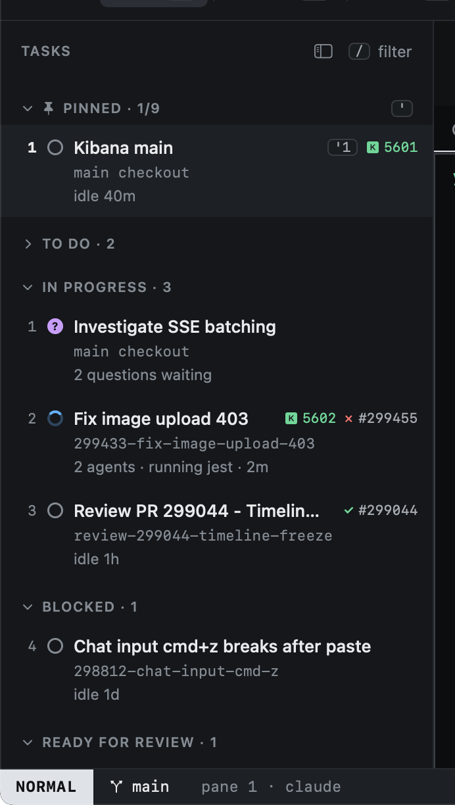

# Agent states

Every session shows its agent's state, and the sidebar sorts by it: whatever needs you comes first.

| State | Means |
|---|---|
| **working** | The agent is busy. |
| **blocked** | It wants permission to run something and cannot go on without you. |
| **asking** | It has questions for you. |
| **done** | It finished its turn. |
| **idle** | Waiting for a prompt. |
| **limited** | It hit a rate or usage limit. |
| **exited** | The agent's process ended. |

## Reported or guessed

Claude reports its state through [hooks](../agents/hooks.md): Heed passes it a small command to call as it works.
Until the first hook arrives (a session just started, imported or resuming), Heed assumes a state and draws it with a
dotted ring. Other agents never report, so their sessions keep the assumed state.

## Where states show

- The sidebar's groups and glyphs, and the inspector's event list.
- The title bar's counts of blocked and asking sessions.
- The [Dock badge](../outside-the-window/dock.md) and the [menu bar item](../outside-the-window/menu-bar.md).
- `ga` jumps to the next session that needs you.
