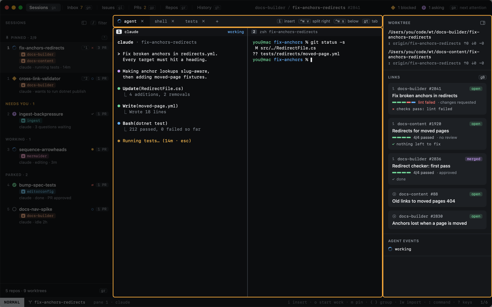

# Sessions

A session is one task: an agent working in a git worktree, the terminals around it, and the pull requests it opens.

A session has:

- **A prompt and a title.** What you asked for, kept for History and for starting again.
- **An agent.** claude, or your own command (which runs without a state), with its own session id so it can resume.
- **One worktree per repo.** Usually one repo; a cross-repo session gets a worktree in each, on the same branch.
- **Panes and tabs.** The agent's terminal, and any shells or tasks you open beside it.
- **Tracked pull requests.** Picked up from what the agent opens, or added by URL.
- **A state.** Working, blocked, asking, done… See [Agent states](agent-states.md).

Heed keeps a record of each session (its prompt, timeline and outcome); the agent keeps its own transcript.

Closing a session keeps its worktree; deleting it removes the worktree too. Either way it moves to
[History](../history/index.md), where it can be reopened.
