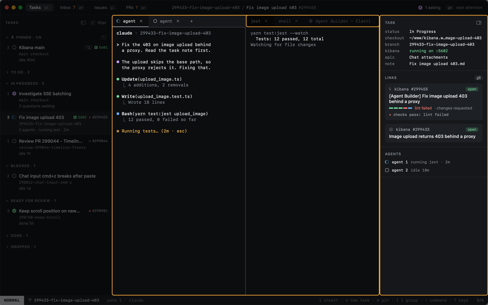

# Tasks

A task is one piece of work on Kibana: one or more agents, the terminals around them, and the issue and pull request
the work is about.

A task has:

- **A title and a status.** In Progress or Blocked tasks are listed in the sidebar. To Do tasks stay on the Kanban;
  Done ones are not listed.
- **A checkout.** Its worktree, or the main Kibana checkout (`~/www/kibana`) when it has none.
- **Agent tabs.** Each runs claude with its own Claude session, so each one resumes on its own. The row shows the most
  urgent of them.
- **Other tabs and panes.** Shells, Kibana itself, and pinned commands such as tests.
- **A PR and an issue.** Set by the agent's `gh pr create`, or by `heed pr add` and `heed issue add`.
- **A Kibana port.** When Kibana runs for the task, its row shows a Kibana icon with the port.
- **A state.** Working, blocked, asking, done… See [Agent states](agent-states.md).

Heed keeps each task's layout, its agent tabs and a short timeline; each agent keeps its own transcript.
