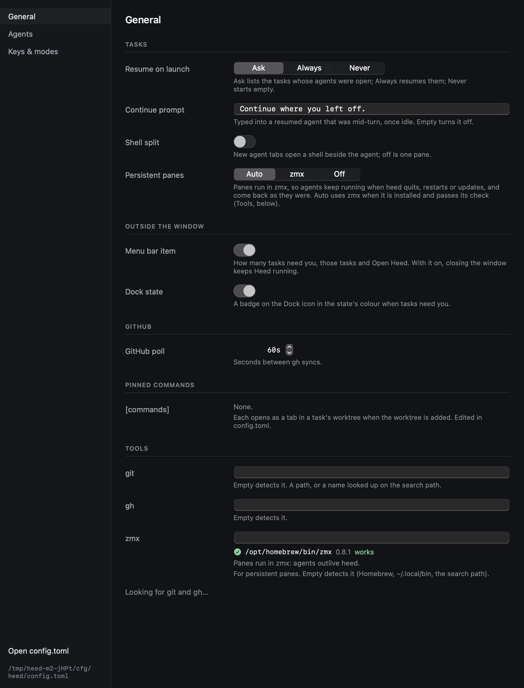
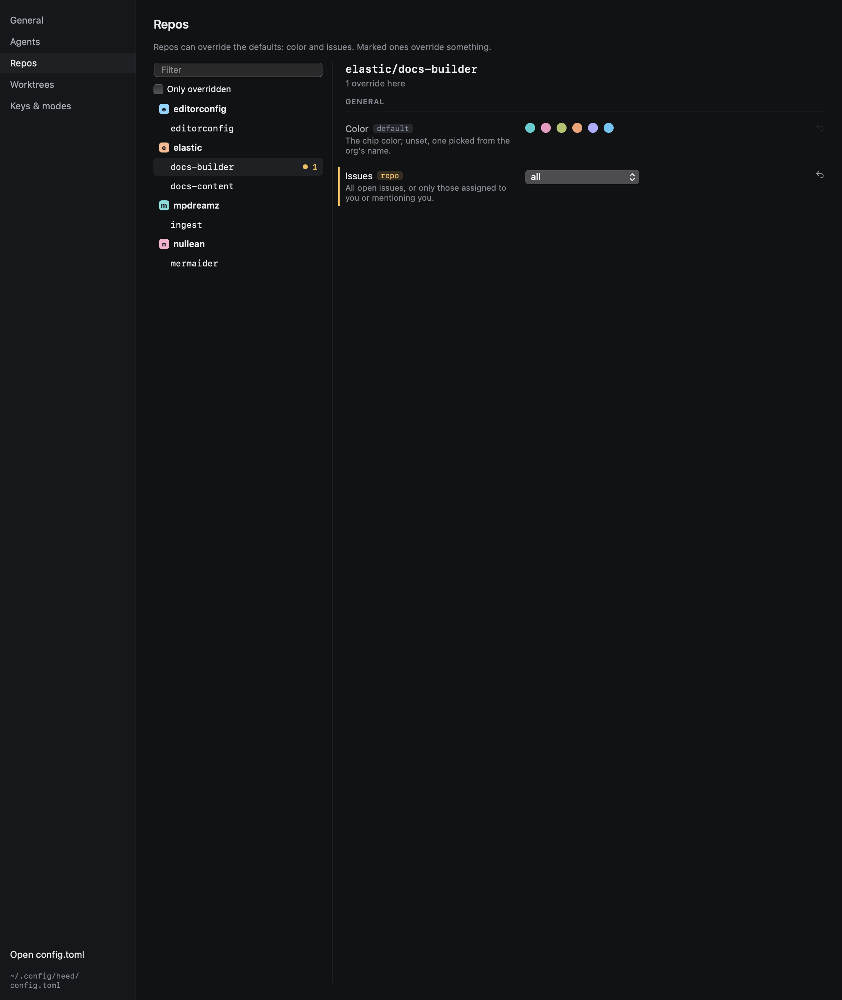

# Settings

`⌘,` opens Settings. It edits `config.toml` in place, keeping its comments; anything you change in the file shows up
here, and the other way round. Key bindings live only in the file.

| Section | Holds |
|---|---|
| **General** | Resume on launch, the continue prompt, shell split, menu bar item, Dock state, GitHub poll interval, issues default, and where `git` and `gh` are |
| **Agents** | Each agent's command, prompt delivery, plan and resume arguments |
| **Repos** | Per repo: colour and issues, with which ones override the defaults (see below) |
| **Worktrees** | Where worktrees go, and the repo roots |
| **Keys & modes** | The INSERT escape chord and every binding as it stands, read-only: bindings are edited in `config.toml` |

## Repos

Every repo heed knows, grouped by org, from the repo list and from `config.toml` (ones you have not cloned here say
so). A marked one, `● 2`, overrides two settings; **Only overridden** hides the rest.

For the selected repo, each setting shows the value that applies and where it comes from: `default` or `repo`.
Overridden rows are marked. Changing a value writes the override (`[repos."elastic/docs-builder"] issues = "all"`); ↺
removes it, and the value falls back to the default. A repo's tasks show here and are edited in the file.

Problems in the file show at the top of Settings as well as in the status bar.
