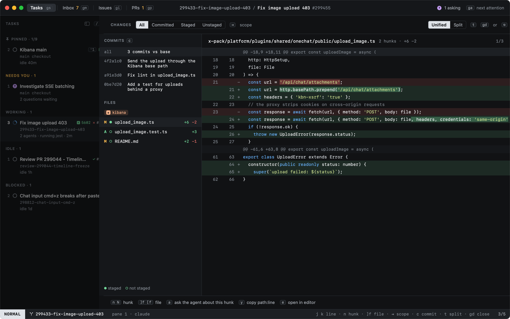

# Diff

`gd` opens the diff overlay for the task's checkout: what changed, file by file, hunk by hunk, with word-level
highlights.

| Key | |
|---|---|
| `⇥` / `⇧⇥` | Scope: **all**, **committed**, **staged**, **unstaged** |
| `c` | One commit at a time (cycles through the branch's commits) |
| `]f` / `[f` | Next / previous file |
| `n` / `N` | Next / previous hunk |
| `j` / `k` | Move by line |
| `gd` or `⎋` | Close |

See [Reviewing changes](reviewing.md) for the split view and acting on a hunk.
