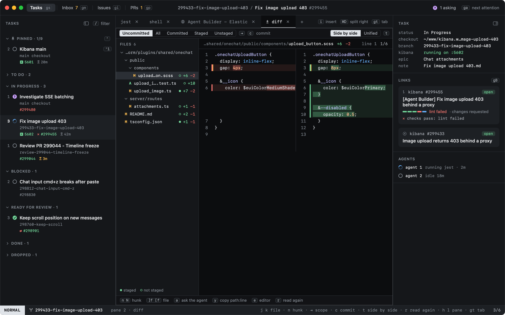
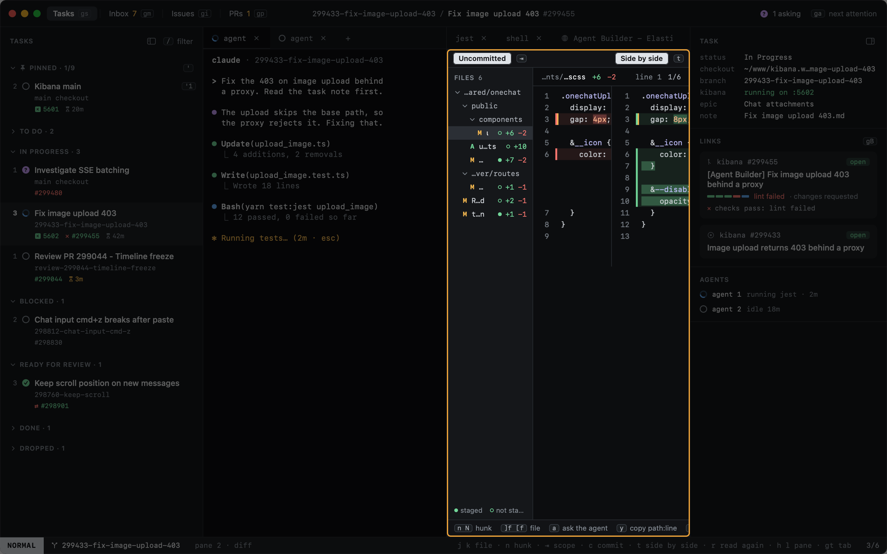
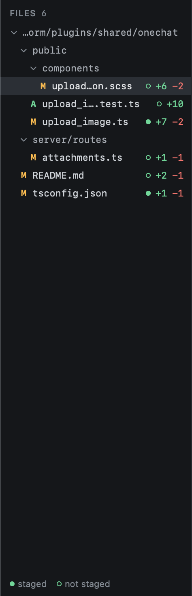

# Diff

`gd` opens the task's **Diff tab** in its work pane, beside the agent, or goes to it when it is open. It shows what
changed in the task's checkout: the changed files as a folder tree on the left, the file you are on on the right, whole,
with the unchanged stretches folded.

The tab stays with the task, like its other tabs, and is there again after a relaunch. It reads the diff when you
show it, and again when the task's agent finishes a turn, so it follows what the agent does; you stay on the same file
and at the same place in it. `r` reads it again now.

## Scopes

| Scope | Compares |
|---|---|
| **Uncommitted** | What is not committed yet, staged or not, against `HEAD`: what your next commit could hold. New files count. The default. |
| **All** | Everything since the branch left `main`: its commits and what is not committed yet |
| **Committed** | The branch's commits, against where it left `main` |
| **Staged** | The index against `HEAD` |
| **Unstaged** | The working tree against the index. New files count. |

`⇥` and `⇧⇥` go through them; `c` shows one commit at a time, newest first, then goes back to Uncommitted. A click on a
scope works too.

## Files

The tree lists folders first, then files, each by name. A folder with nothing but one folder in it shares its row
(`x-pack/platform/plugins`), so deep paths stay short; a click folds or opens it. Each file has its status (`M`
modified, `A` added, `D` deleted, `R` renamed), a dot that is filled when the file is staged, and the lines added and
removed.

| Key | |
|---|---|
| `j` / `k`, `]f` / `[f` | Next / previous file |
| `n` / `N` | Next / previous hunk; past the last one, the next file's first |
| `⌃d` / `⌃u` | Half a page down / up |
| `⇥` / `⇧⇥` | Next / previous scope |
| `c` | One commit (cycles) |
| `t` | Side by side or unified |
| `r` | Read the diff again |

These keys work while the Diff tab has the keys (NORMAL); `h` `l`, `gt` and the other pane and tab keys work as
anywhere. A binary file, or one over 1 MB or 20,000 lines, gets a message instead of a diff; `e` still opens it.

See [Reviewing changes](reviewing.md) for side by side and unified, and acting on a line.
