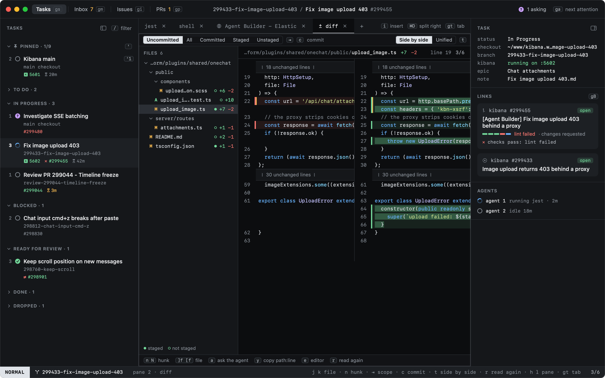
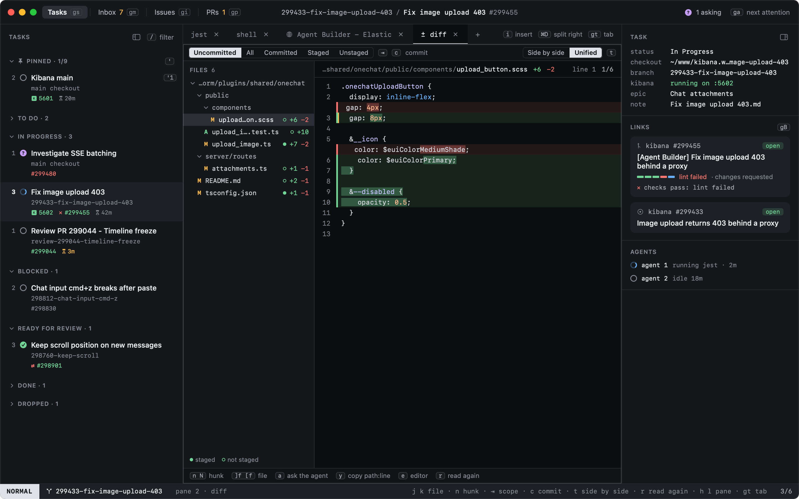

# Reviewing changes

The Diff tab shows the whole file, with the old version on the left and the new one on the right. Unchanged stretches
are folded to a line saying how many lines they hide; a click opens one. Changed words within a line are highlighted,
so a one-character fix stands out in a long line, and TypeScript, JavaScript, JSON, CSS and SCSS, Markdown, YAML and
HTML are highlighted by language.

`t` switches to unified, with the removed lines above the added ones in one column, and back. Heed remembers the choice
for every Diff tab.

The mouse scrolls, and you can select and copy text (`⌘C`). The diff is read only.

## Acting on a line

The line you act on is the one you clicked, else the hunk `n` and `N` took you to, else the hunk at the top of the
view. The header shows it.

| Key | |
|---|---|
| `a` | Ask the agent: `About <path> around line <n> (the hunk in my diff): ` is typed into the agent's pane, unsent, and you are in INSERT there to finish the question |
| `y` | Copy `path:line` |
| `e` | Open the file in the app that opens it |
