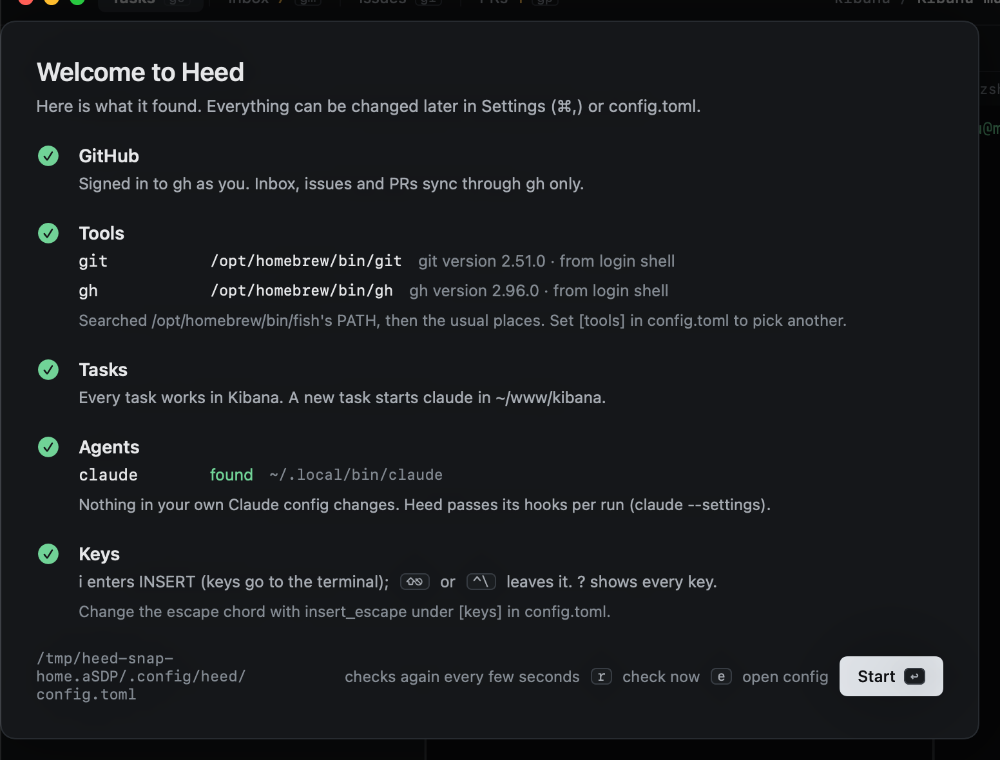

# The first run

The first time it opens, Heed shows what it found. It checks again every few seconds while the screen is open, so
signing in to `gh` or installing an agent in another terminal shows up without a restart.

- **GitHub**: whether `gh` is signed in. Heed talks to GitHub only through `gh`; it never asks for a token.
- **Tools**: where `git` and `gh` are, found through your login shell's PATH and the usual install locations. See
  [Finding git and gh](../configuration/tools.md).
- **Repos**: the repositories under `~/Projects` and `~/code` (change them with `repo_roots`).
- **Agents**: which of claude, codex, cursor, pi, opencode and gemini are installed.

Nothing in your own agent configuration changes: Heed passes its hooks to each agent per run. See
[Hooks](../agents/hooks.md).

| Key | |
|---|---|
| `↩` | Start using Heed |
| `r` | Check again now |
| `e` | Open `config.toml` |

`:welcome` shows this screen again later.

## Configuration

Everything lives in `~/.config/heed/config.toml`, written with comments the first time Heed opens. Saving it applies
the change right away. Settings (`⌘,`) edits the same file, except key bindings, which live only in the file. See
[Configuration](../configuration/index.md).
