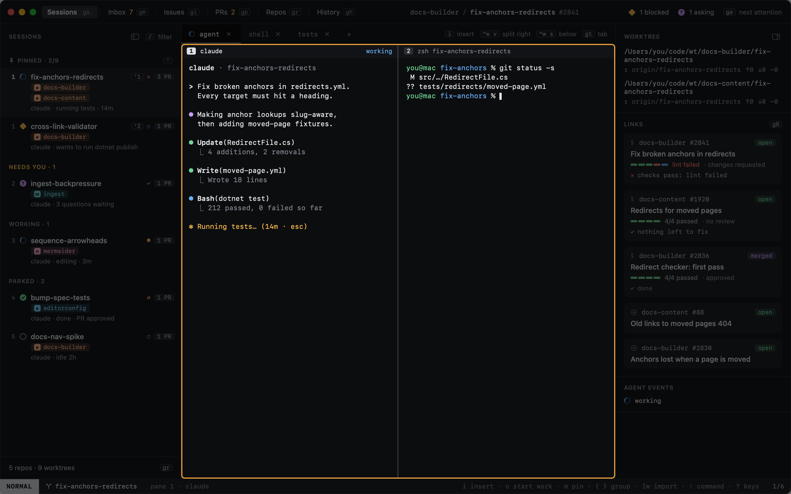
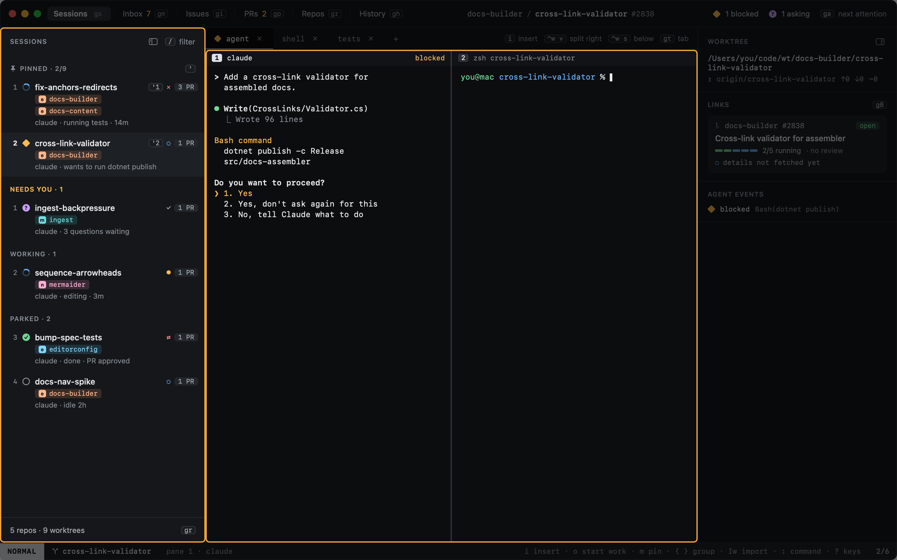
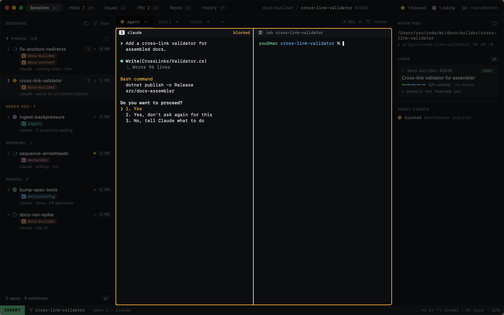
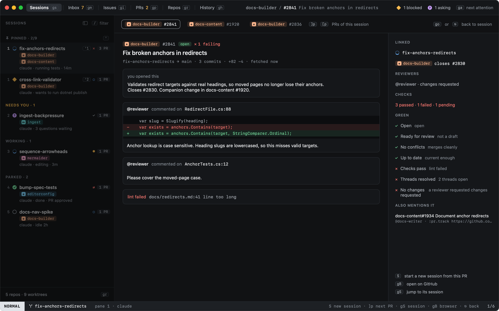
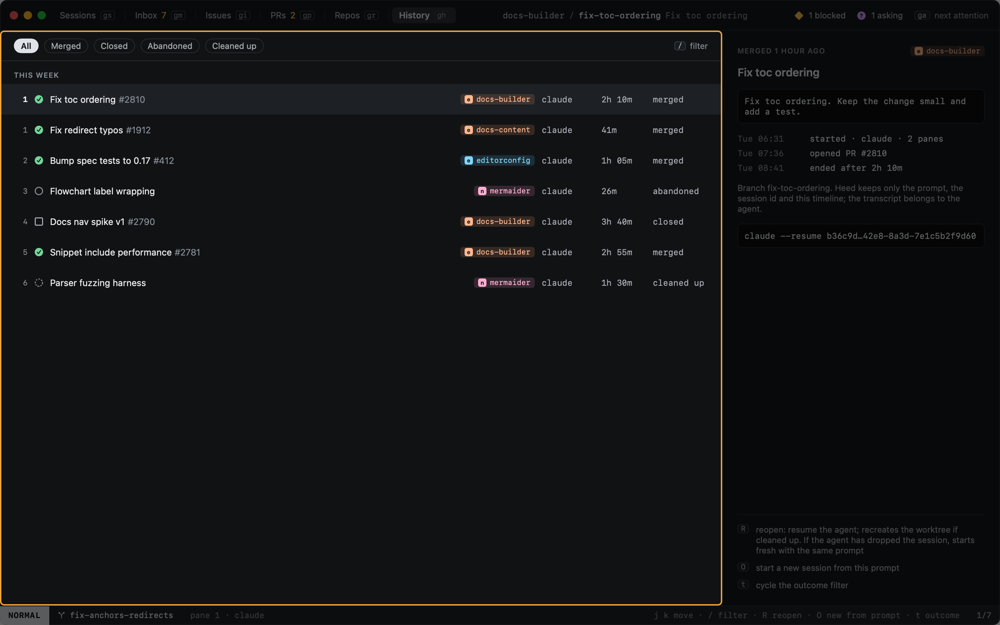

# Your first session

This walks through one task from start to finish. Each step links to the page that covers it in full.

## 1. Describe the task

Press `o` and describe what you want done. Heed guesses the repo from your words and recent sessions, names a branch
from the first word (`Fix …` becomes `fix/…`), and shows the command it will run. `⌘↩` starts it.

Heed makes a git worktree for the branch, opens a session for it, and starts the agent on your prompt.
More in [Start work](../start-work/index.md).

## 2. The agent works

The session's agent runs in a real terminal. Its state, here **working**, comes from the agent itself through hooks,
and sorts the session in the sidebar.

## 3. It needs you

When an agent wants permission or asks a question, its session moves up under **Needs you**, and the Dock and the
menu bar show how many are waiting. `ga` jumps to the next one.

## 4. Answer it

Press `i` to type into the agent: the pane taking your keys gets a white border. Answer, then `⇧⎋` to give the
keyboard back to Heed. More in [Typing into agents](../sessions/typing-into-agents.md).

## 5. Read what the PR needs

When the agent opens a pull request, the session tracks it, and its state shows on the row. `go` opens the PR
overlay: review comments with the code they are on, failing checks, and what holds the PR back from green. You decide
what the agent fixes. More in [The PR overlay](../github/pr-overlay.md).

## 6. Done

When the pull request is merged, the session moves to History with its outcome. Its prompt, timeline and agent session
stay there, ready to reopen. More in [History](../history/index.md).

