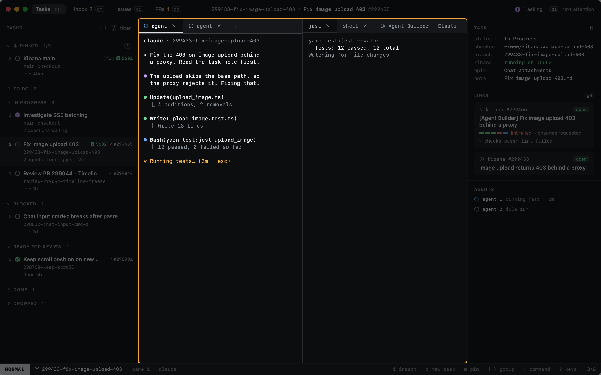
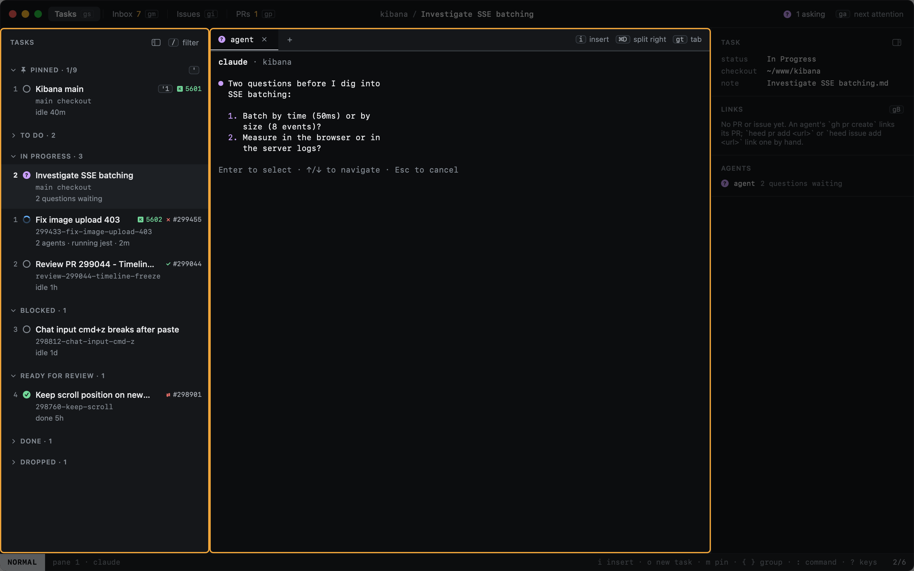
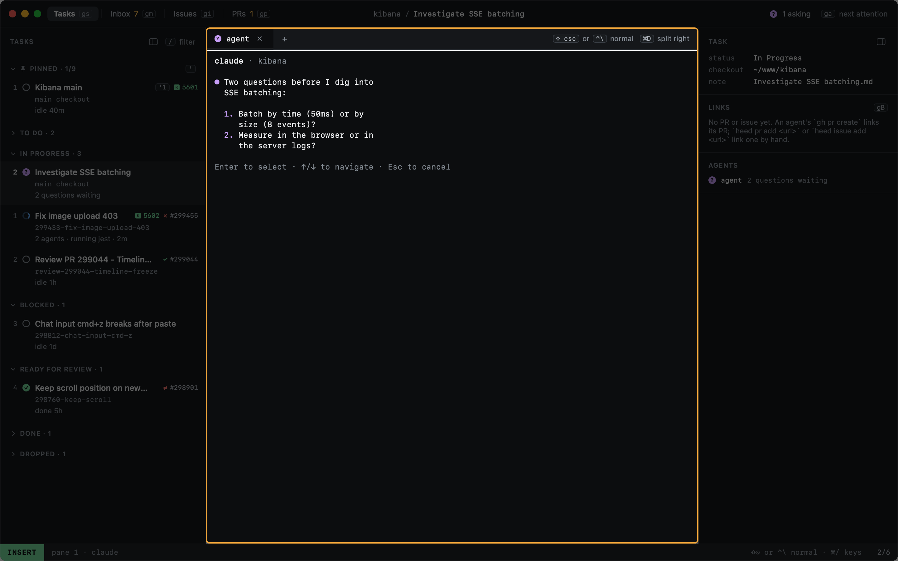
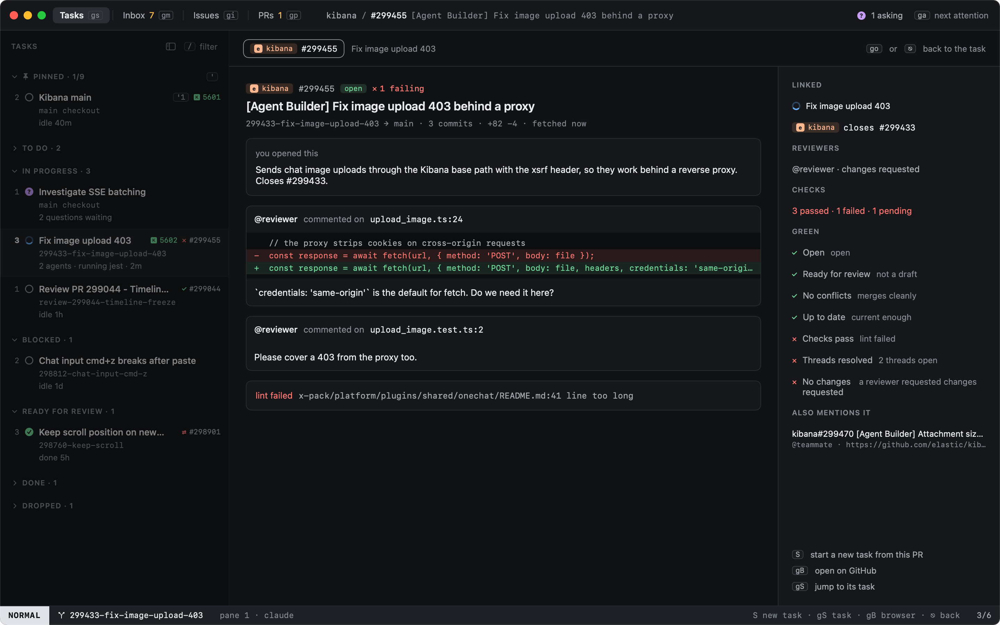

# Your first task

This walks through one task from start to finish. Each step links to the page that covers it in full.

## 1. Name the task

Press `o` and type a title. That is all the dialog asks for. `↩` creates the task and starts claude on it in the
Kibana checkout, `~/www/kibana`.

More in [New task](../tasks/new-task.md).

## 2. The agent works

The task's agent runs in a real terminal. Its state, here **working**, comes from the agent itself through hooks,
and shows on the task's row in the sidebar. A task can have more than one agent tab; the row shows the most urgent one.

## 3. It needs you

When an agent wants permission or asks a question, its row's glyph says so, and the Dock and the menu bar show how
many are waiting. `ga` jumps to the next one.

## 4. Answer it

Press `i` to type into the agent: the pane taking your keys gets a white border. Answer, then `⇧⎋` to give the
keyboard back to Heed. More in [Typing into agents](../tasks/typing-into-agents.md).

## 5. Read what the PR needs

When the agent opens a pull request, it becomes the task's PR, and its state shows on the row. `go` opens the PR
overlay: review comments with the code they are on, failing checks, and what holds the PR back from green. You decide
what the agent fixes. More in [The PR overlay](../github/pr-overlay.md) and [A task's PR](../github/task-prs.md).

