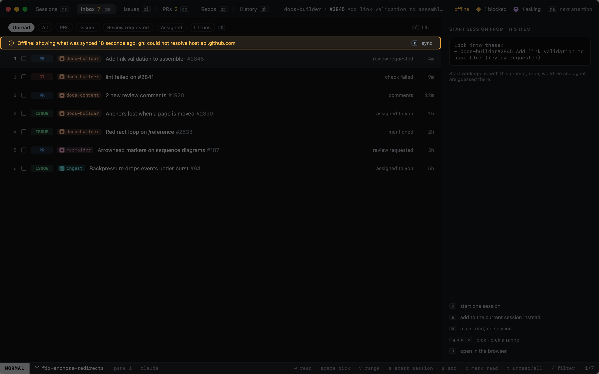

# GitHub

Heed talks to GitHub only through the [GitHub CLI](https://cli.github.com): it never asks for a token. Sign in once
with `gh auth login` and Heed keeps it in sync: what the view on screen shows every minute (`poll_seconds` under
`[github]`), the rest every five, and `r` syncs everything now. A task's PR details are fetched when you open it and
when its checks or review threads change.

| View | Key | Shows |
|---|---|---|
| [Inbox](inbox.md) | `gm` | Your notifications |
| [Issues](issues.md) | `gi` | Issues assigned to you or mentioning you |
| [Pull requests](pull-requests.md) | `gp` | Your open pull requests and your tasks' PRs |

From any of them you can [read](reading.md) an item in the app and [make a new task](../tasks/new-task.md#from-github)
from it. A task's own PR opens in the [PR overlay](pr-overlay.md), with what holds it back from green.

## When GitHub can't be reached

Heed keeps the last sync and keeps working. A banner says when the data was synced and why it is stale.

Items in orgs your `gh` token is not authorized for (SAML single sign-on) are counted in the title bar ("· 49 hidden")
rather than shown. `gh auth refresh`, or authorizing the GitHub CLI for that org, brings them in.
