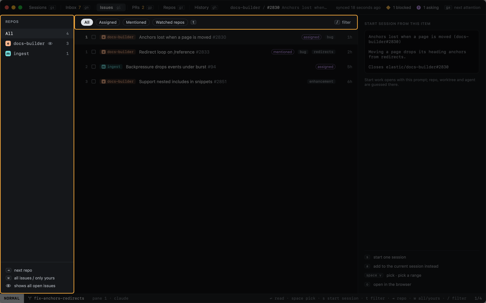
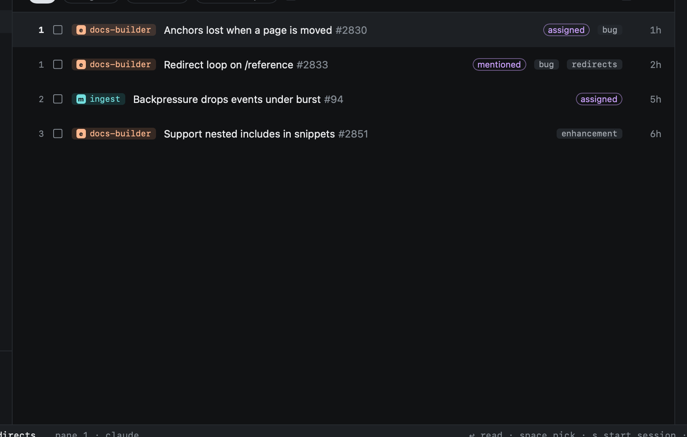

# Issues

`gi` shows open issues assigned to you or mentioning you, in every repo.

## Filters

| Chip (`t` cycles) | Shows |
|---|---|
| All | Everything shown |
| Assigned | Assigned to you |
| Mentioned | Mentioning you |

`⇥` and `⇧⇥` move through the repo column; clicking a repo works too. Issues take the same keys as the
[Inbox](inbox.md): `space`, `s`, `go`.

