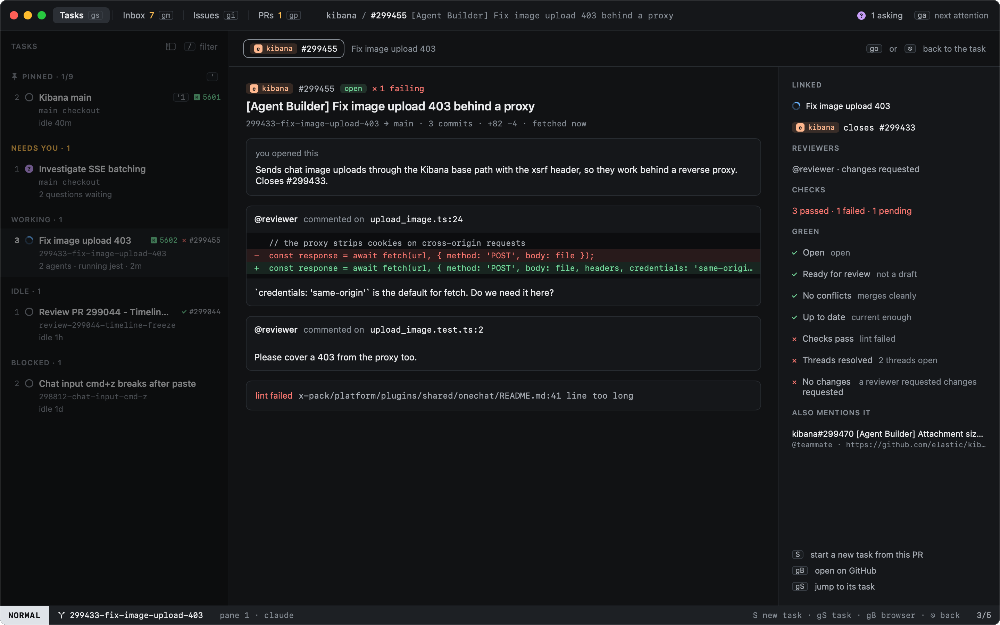

# The PR overlay

In Tasks, `go` opens the PR overlay over the task's pull request: its description, the unresolved review threads with
the code they are on, and the failing checks. `go` again, or `⎋`, goes back to the task.

Heed only reads: it sends nothing to the agent and changes nothing on GitHub. You decide what the agent fixes: tell
it in its pane, or make a new task with `S`, whose first prompt lists the open threads and failing checks.

| Key | |
|---|---|
| `S` | New task from this PR |
| `gS` | Jump to the task working on it |
| `gB` | Open it on GitHub |
| `r` | Sync now |

## Green

Beside the threads, the overlay lists the PR's reviewers and checks, and whether it is **green**: GitHub has nothing
left to object to in the code. Each rule shows what it found:

| Rule | Holds when |
|---|---|
| Open | not merged or closed |
| Ready for review | not a draft |
| No conflicts | it merges cleanly into its base |
| Up to date | not behind the base, when the repo requires branches to be current |
| Checks pass | every required check passed (every check, when the repo requires none) |
| Threads resolved | no review thread is open |
| No changes requested | no reviewer is waiting on changes |

## The state of a PR

The same state shows wherever a PR does: by the PR number on a task's sidebar row, on the inspector's PR card (with
the first rule holding it back), and in the PRs view's **State** column.

| Mark | |
|---|---|
| ✕ failing | a check failed |
| ⇄ conflict / behind | it conflicts with its base, or is behind it when the repo requires current branches |
| ● threads | review threads are open, or a reviewer requested changes |
| ◌ running / draft | checks are still running, GitHub is still working out mergeability, or it is a draft |
| ✓ green | every green rule holds |
| ✓ passing | checks pass by the last sync; the details are not fetched yet |
| merged / closed | done |

Details are fetched for your tasks' PRs: the one on screen every time, the others when the last sync says their
checks or threads moved.
