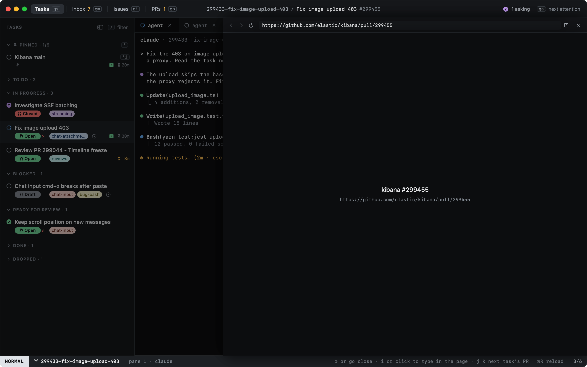

# The PR panel

Click the PR pill on a task's sidebar row, press `go`, or right-click the task and pick **Pull request**. The PR's
GitHub page slides in from the right, over the task. The rest of the window is dimmed; click there, press `⎋`, or
`go` again, and it hides.

It is GitHub's own page: the conversation, the files changed, the checks, everything GitHub shows, signed in as your
[web pages](../tasks/web-pages.md) are. Nothing is rebuilt in Heed and nothing is fetched for it beyond the page.

The panel always shows the PR of the task you are on. `j` and `k` move to the next task and the panel follows with
its PR; a task with none closes it. The pages of the last few PRs you opened stay loaded, so going back to one is
instant and it is where you left it.

| Key | |
|---|---|
| `go`, `⎋` | Hide the panel |
| `i`, or a click in the page | Type in the page (INSERT), to write a comment; `⇧⎋` back |
| `⌘[` `⌘]` | Back, forward |
| `⌘R` | Reload |
| `⌘L` | Type an address |

A link goes to its page inside the panel. A link that opens a new window opens as a page tab of the task instead, and
the panel hides so you see it; a ⌘-click opens it behind the panel. The toolbar's last button opens the page in your
default browser.

To read the PR inside Heed instead (open threads with their code, failing checks, the green rules),
`:overlay.pr` opens the [PR overlay](pr-overlay.md).
