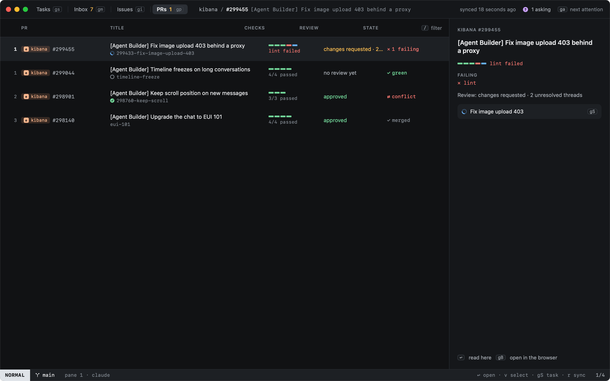

# Pull requests

`gp` lists your open pull requests, and your tasks' PRs.

Each row shows:

- **The branch**, with the state of the task working on it.
- **Checks**: one segment per check, green passed, red failed, blue running, with the failing one named.
- **Review**: approved, changes requested, or waiting, and how many review threads are unresolved.
- **State**: where it stands, the same mark the sidebar shows (see [the state of a PR](pr-overlay.md#the-state-of-a-pr)).

| Key | |
|---|---|
| `go`, `↩` | [Read](reading.md) it in the app |
| `gS` | Jump to the task working on it |
| `gB` | Open in the browser |
| `r` | Sync now |

The title bar counts the pull requests that need you (failing checks, changes requested).
