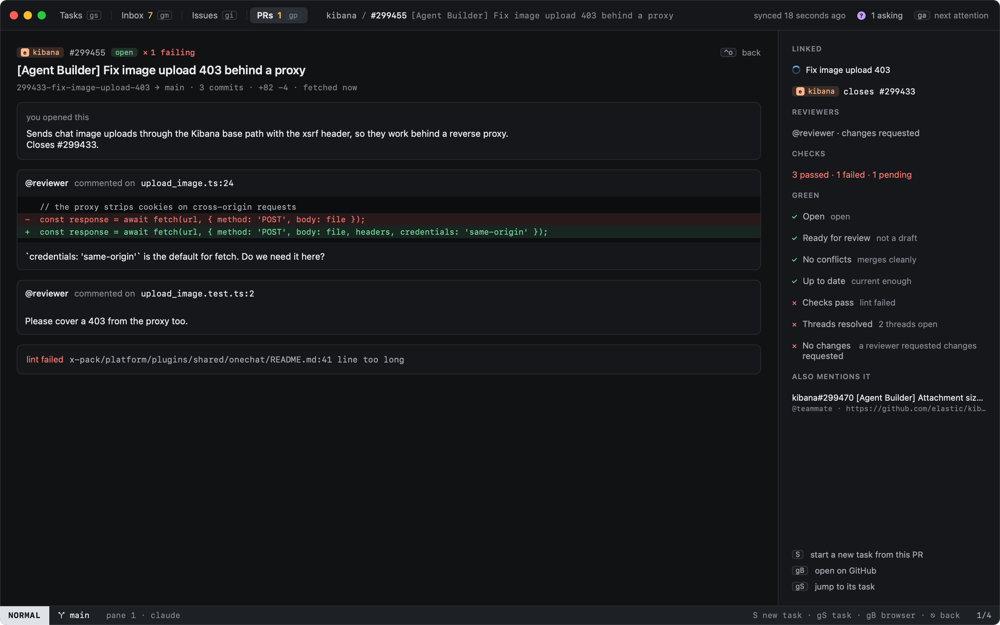
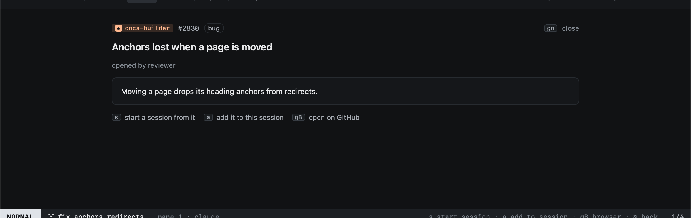

# Reading PRs and issues

`go` (or `↩`) on a pull request or an issue opens it in the app. `go` again, or `⌃o`, goes back.

## Pull requests

The reader shows the description, the unresolved review threads with the code they are on, and the failing checks;
beside them its reviewers, checks and [green rules](pr-overlay.md#green). It is the [PR overlay](pr-overlay.md)'s view,
for any PR: `S` makes a new task from it, `gS` jumps to the task working on it.

## Issues

The issue reader shows the title, labels, author and body. From it:

| Key | |
|---|---|
| `s` | [New task](../tasks/new-task.md#from-github) from it |
| `gB` | Open it on GitHub |

Inbox issues that are not assigned to you show only their title, as only those are synced in full.
