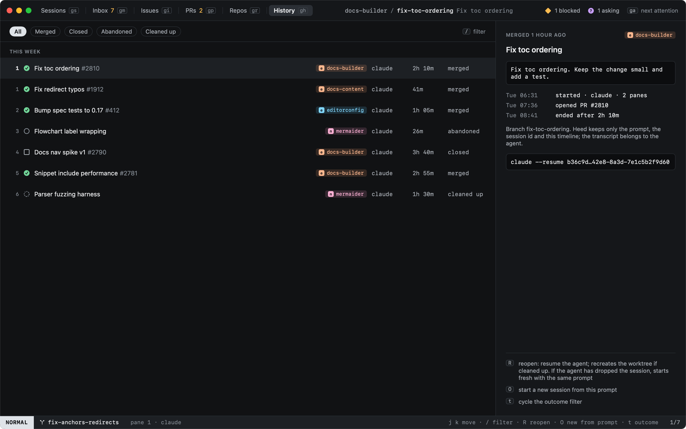

# History

`gh` lists sessions that ended, grouped by day, with their outcome.

| Outcome | |
|---|---|
| merged | Its pull request was merged |
| closed | Closed by you, with a pull request |
| abandoned | Closed without one |
| cleaned up | Its worktree was removed |

`t` cycles the outcome filter and `/` searches titles, prompts and branches. The detail shows the prompt, the
timeline (started, PR opened, ended) and the agent's resume command.

Heed keeps only the prompt, the session id and the timeline; the transcript belongs to the agent.

See [Reopening](reopening.md) to pick a session up again.
