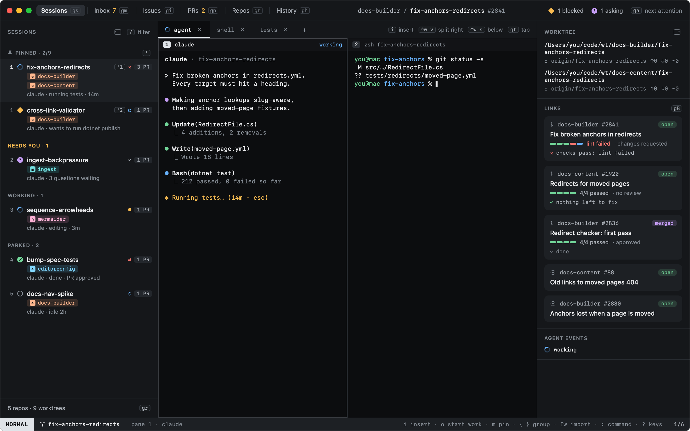

# Heed

Keep an eye on every agent.

Heed is a native macOS app for working with coding agents. It runs agents and shells in real terminals, gives each
task its own git worktree, and keeps the GitHub issues and pull requests around that task in view. It tells you which
agent needs you, and it gets you there in a keystroke.

## Where to go next

| | |
|---|---|
| [Getting started](getting-started/index.md) | Install Heed, see what the first run finds, and walk through a first session. |
| [Concepts](concepts/index.md) | Sessions, agent states, worktrees and modes: the four ideas the rest builds on. |
| [Sessions](sessions/index.md) | The main view: moving around, typing into agents, panes and tabs. |
| [Start work](start-work/index.md) | From a sentence to a running agent in its own worktree. |
| [GitHub](github/index.md) | Your inbox, issues and pull requests, and what holds each PR back from green. |
| [Keyboard](keyboard/index.md) | Every key, how keys work, and how to change them. |
