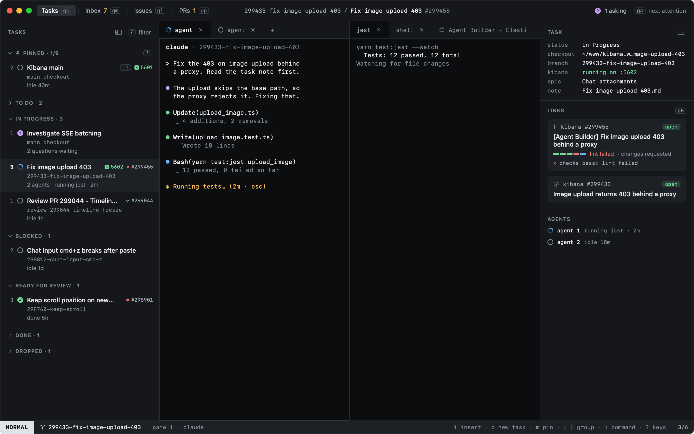

# Heed

Keep an eye on every agent.

Heed is a native macOS app for working on Kibana with coding agents. Each task gets its agents and shells in real
terminals, and keeps the GitHub issue and pull request around it in view. Heed tells you which agent needs you, and it
gets you there in a keystroke.

## Where to go next

| | |
|---|---|
| [Getting started](getting-started/index.md) | Install Heed, see what the first run finds, and walk through a first task. |
| [Concepts](concepts/index.md) | Tasks, agent states and modes: the three ideas the rest builds on. |
| [Tasks](tasks/index.md) | The main view: new tasks, moving around, typing into agents, panes and tabs. |
| [GitHub](github/index.md) | Your inbox, issues and pull requests, and what holds each PR back from green. |
| [Keyboard](keyboard/index.md) | Every key, how keys work, and how to change them. |
