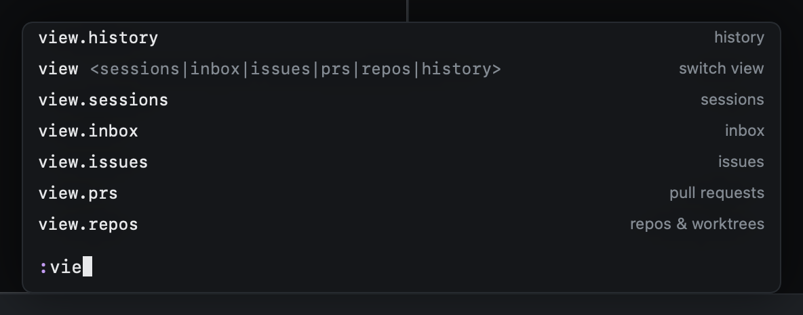

# The command line

`:` opens the command line. Every command has a name, and `:` runs any of them, with completion.

| Key | |
|---|---|
| `⇥` | Complete |
| `↩` | Run |
| `⎋` | Close |

Short forms work too:

| Typed | Runs |
|---|---|
| `:start <prompt>` | Start work with that prompt |
| `:agent codex` | Start work with that agent |
| `:pr 2841` | Read pull request 2841 |
| `:track <url>` | Track a pull request in this session (`gU` takes the URL on the clipboard) |
| `:inbox`, `:prs`, … | Switch view |
| `:import <path>` | Import the worktree at a path |
| `:help` | Every key |
| `:q` | Quit |

## Commands without a key

Everything you can do with the mouse, the menu bar or a global shortcut is a command too, so `:` reaches it and
`config.toml` can bind it:

| Command | |
|---|---|
| `:session.open <words>` | Go to the first session matching the words |
| `:tab.go <n>` | Go to tab n |
| `:filter.clear` | Clear the view's filter |
| `:issues.repo [name]` | Show one repo's issues; no name shows every repo |
| `:resume` | The "pick up where you left off" dialog, as on launch |
| `:work.start.panel` | Start work in the floating panel |
| `:settings.open [section]` | Settings, on `general`, `agents`, `colors`, `worktrees` or `keys` |
| `:app.activate` | Bring the window to the front |
| `:repo.add <path>` | Add a repo outside the scanned folders |

The [key reference](reference.md) lists every command name.
