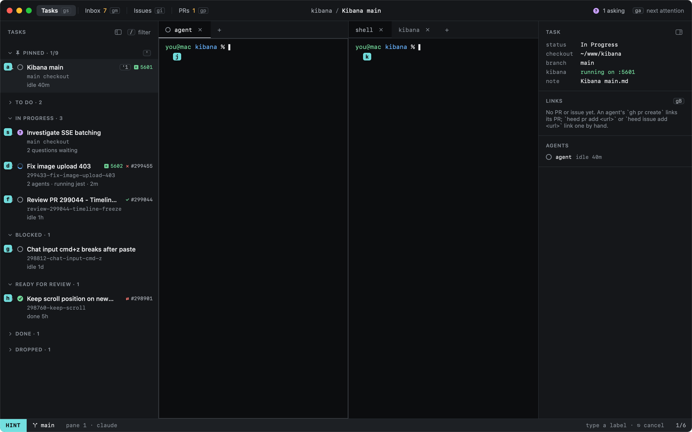
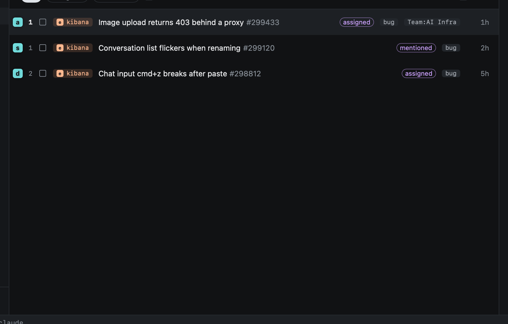

# Hints

`f` labels everything you can jump to in the current view; type a label to go there.

| Key | |
|---|---|
| `f` | Jump: the cursor moves there |
| `F` | Jump and act: a pane enters INSERT, a list row opens |
| `⎋` | Cancel |

In Tasks the labels go on tasks and panes; in Inbox, Issues and PRs they go on the list's rows.

