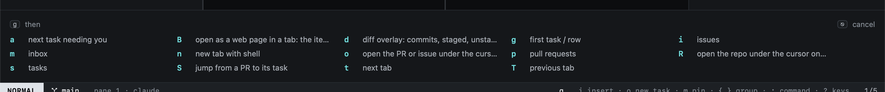

# Keyboard

Everything in Heed is a key or two away, in [modes](../concepts/modes.md) like vim's. In NORMAL every key is a command;
in INSERT your keys go to the focused terminal.

## Sequences

Many commands are two keys: `g` then a letter for views (`gm` Inbox), `⌃w` then a letter for panes (`⌃w v` split).
Press the first key and wait: a panel at the bottom lists every key that can follow, and what it does.

`⎋` drops a sequence you started. A number before a command repeats it (`3j`), as in vim.

## How the keys are laid out

Single keys are kept for what you do many times an hour; anything rarer is two keys, grouped by its first:

| Keys | |
|---|---|
| `j` `k` `h` `l` `G` `/` `f` | Move, filter, jump |
| `⌃d` `⌃u`, `{` `}` | Half a page; the previous or next group (a sidebar group, a repo) |
| `↩` `o` `i` `v` `m` | Open, new task, type into the agent, select, pin |
| `r` | Refresh the view you are in |
| `g…` | Go somewhere: views (`gm` Inbox), overlays (`go`, `gd`), tabs (`gt`), a link as a web page (`gB`), the repo on GitHub (`gR`) |
| `z…` | Toggles: `zi` inspector, `zs` sidebar |
| `'…` | Jump to a pin (`'1`–`'9`), or back (`''`) |
| `]…` `[…` | Next or previous of a kind: `]f` file |
| `⌃w…` | Panes |

A key means the same thing in every view where it means anything: `o` always makes a new task, and `s` makes one from
what you picked.

## Views have their own keys

Some keys only mean something in one view: `s` makes a new task in the Inbox, `x` marks an Inbox item read. Those
come first there; elsewhere the same key is free or means something else. The status bar always lists the keys that
matter in the view you are in, and `?` shows every key.

## In this section

- [Views](views.md) · [Hints](hints.md) · [The command line](command-line.md) · [Selecting](visual.md)
- [Mac shortcuts](mac-shortcuts.md) · [Customizing keys](customizing.md) · [Key reference](reference.md)
