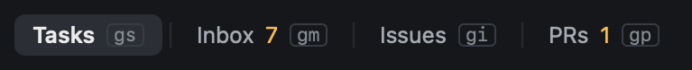

# Views

Heed has seven views, named along the top with their keys. Every view key starts with `g`.

| Key | View |
|---|---|
| `gs` | [Sessions](../sessions/index.md) |
| `gm` | [Inbox](../github/inbox.md) |
| `gi` | [Issues](../github/issues.md) |
| `gp` | [Pull requests](../github/pull-requests.md) |
| `gr` | [Repos](../worktrees/index.md) |
| `gh` | [History](../history/index.md) |

Clicking a view's name works too, and `:inbox`, `:prs` and the rest switch by name. The middle of the title bar shows
what you are looking at: the session's branch and PR, or the item under the cursor. On narrow windows the view keys
are hidden first, never the names.

`⎋` closes an overlay or a reader, but never changes the view: views are places of their own.
