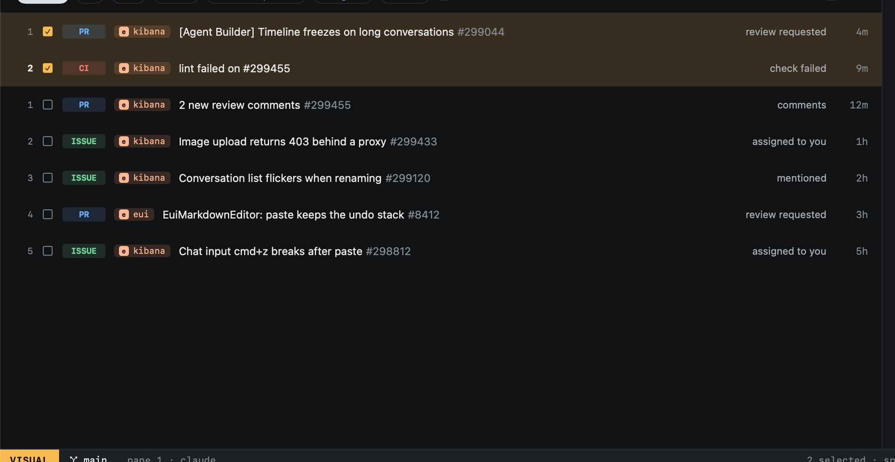

# Selecting

`v` starts VISUAL: move to extend the selection from where you started, `space` to add or drop single rows, then act
on all of them at once.

| Key | |
|---|---|
| `j` `k` `gg` `G` | Extend the selection |
| `space` | Add or drop the row under the cursor |
| `s` | [New task](../tasks/new-task.md#from-github) from the selected (Inbox and Issues) |
| `x` | Mark the selected read (Inbox) |
| `⎋` | Back to NORMAL |

In the Inbox and Issues, `space` picks items without VISUAL too, for a new task from several at once.
