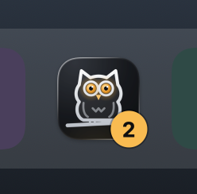

# The Dock

When tasks need you, Heed's Dock icon gets a badge with how many. Its colour is the state's: amber when one is
blocked, violet when they are only asking.



```toml
[ui]
dock_state = true
```

Both this and the [menu bar item](menu-bar.md) can be turned off in Settings (`⌘,`).
