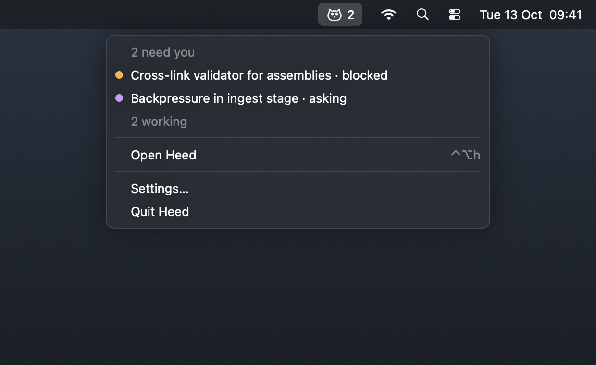

# The menu bar

The owl in the menu bar shows how many tasks need you, beside it when there are any.


Its menu lists the tasks waiting on you (choosing one opens Heed on it), how many are working, and:



| Item | |
|---|---|
| Open Heed | Heed to the front, reopening its window if it was closed |
| Settings… | Settings |
| Quit Heed | Quit; with agents running, Heed asks first |

With the menu bar item on, **closing the window keeps Heed running**, and every agent with it. Without it, closing the
window quits.

```toml
[ui]
menu_bar = true
```
