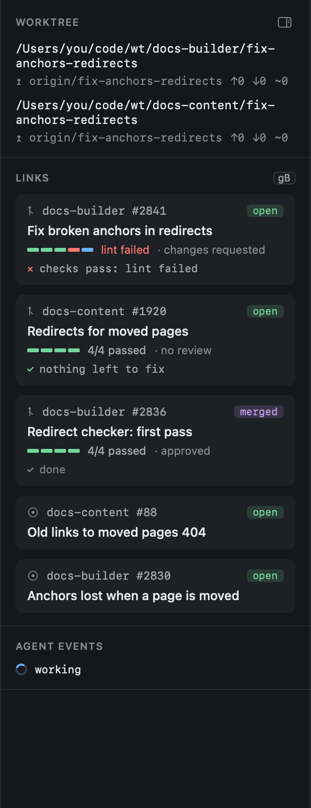
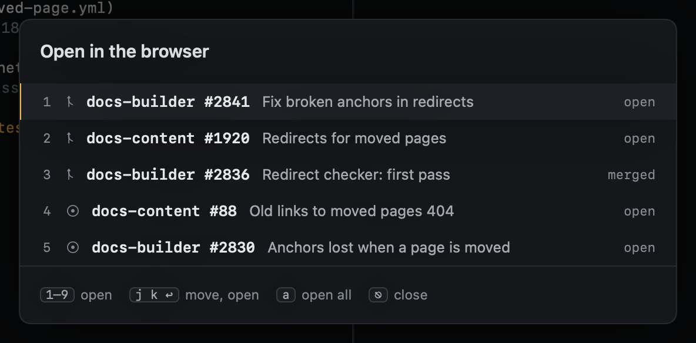

# The inspector

The inspector, on the right of the Sessions view, shows the selected session's surroundings.

- **Worktrees**: each worktree's path, its upstream, how far ahead and behind it is, and whether it has uncommitted
  changes.
- **Links**: the session's pull requests, then its issues. Open PRs come first, then merged, then closed; each shows
  its checks bar, its review state, its [state](../github/pr-overlay.md#the-state-of-a-pr), and the first green rule
  holding it back. A merged or closed PR keeps its checks as they
  finished and says it is done. Issues show their title and whether they are open.
- **Agent events**: the latest states the agent reported, newest first. A turn's working steps show while it runs and
  fold away once it ends, leaving how it ended.

## Links

**Click a link** to open it here: a PR in the [PR overlay](../github/pr-overlay.md), an issue in the
[reader](../github/reading.md). **⌘-click** opens it on GitHub. `go` opens the PR overlay from the keyboard.

A session's issues come from three places:

- its prompt's closing words: `Fixes #12`, `Closes org/repo#3`, `Resolves <issue URL>`. Start work from
  [Issues](../github/issues.md) writes these for you;
- the issues its PRs close, as GitHub reports them;
- `heed issue add <url>` from the agent, or `:issue.add <url>` (the copied URL when you give none). `:issue.remove`
  takes one off.

With no PR and no issue yet, the inspector says what comes next. A pushed branch offers **Open a PR on GitHub**, the
compare page for the branch.

### Opening them in the browser

| Key | |
|---|---|
| `gB` | One link opens it. Several open a picker: `1`–`9` opens one, `j` `k` `↩` too, `a` opens all, `⎋` closes. None opens the repo. |
| `gR` | The repo on GitHub (a session in several repos asks which) |

In the other views `gB` opens the item under the cursor and `gR` its repo.

`zi` collapses and expands the inspector. It also gives way first when the window is narrow.
