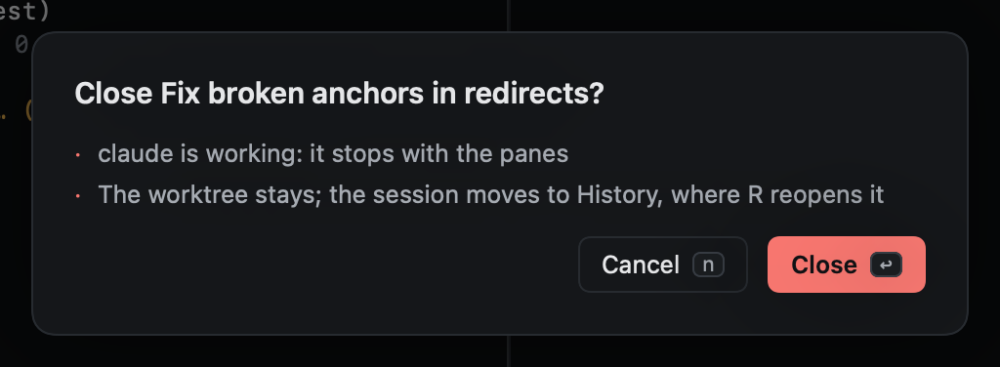
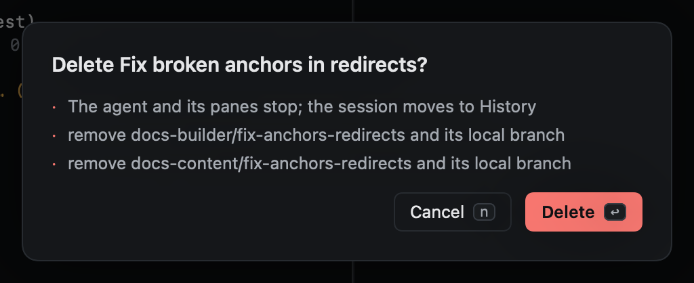

# Pin, park, close, delete

| Key | Does | Keeps |
|---|---|---|
| `m` | Pin or unpin (mark, as in vim): pinned sessions stay at the top, and `'1`–`'9` jump to them | Everything |
| `zz` | Park: move the session out of the way, to **Parked** | Everything; the agent keeps running |
| `x` | Close: the agent and panes stop, the session goes to History | The worktree and branch |
| `dd` | Delete: close, and remove its worktrees and their local branches | Worktrees with unsaved work |
## Closing and deleting ask first

Both ask before doing anything, and say exactly what will happen. `y` or `↩` goes ahead; `n`, `⎋` or `q` cancels.

Deleting never removes a worktree with uncommitted changes or unpushed commits: the dialog lists those under **Kept**,
with the reason.

Closed and deleted sessions stay in [History](../history/index.md), where `R` reopens them (recreating the worktree
from its branch if it was removed).
