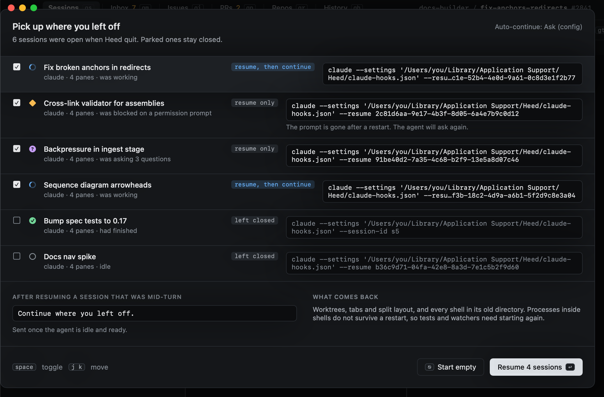

# Resuming sessions

When Heed starts, the sessions that were open come back. (With `persist = "zmx"` their agents never stopped, and
their panes reattach instead: see [Agents that outlive Heed](zmx.md).) Whether their agents resume is up to `resume_on_launch`
under `[sessions]`:

| Value | On launch |
|---|---|
| `ask` | List the sessions that were open and let you pick which agents to resume (the default) |
| `always` | Resume them all |
| `never` | Open plain shells; resume by hand |

Resuming uses the agent's own resume (`claude --resume <id>`) with the session id Heed kept.
If the agent no longer has that session, Heed says so and starts the agent fresh with the original prompt.

## The continue prompt

A session that was mid-turn when Heed quit gets a nudge once its agent is idle again: `continue_prompt`, by default
"Continue where you left off.". Set it to `""` to turn it off.
