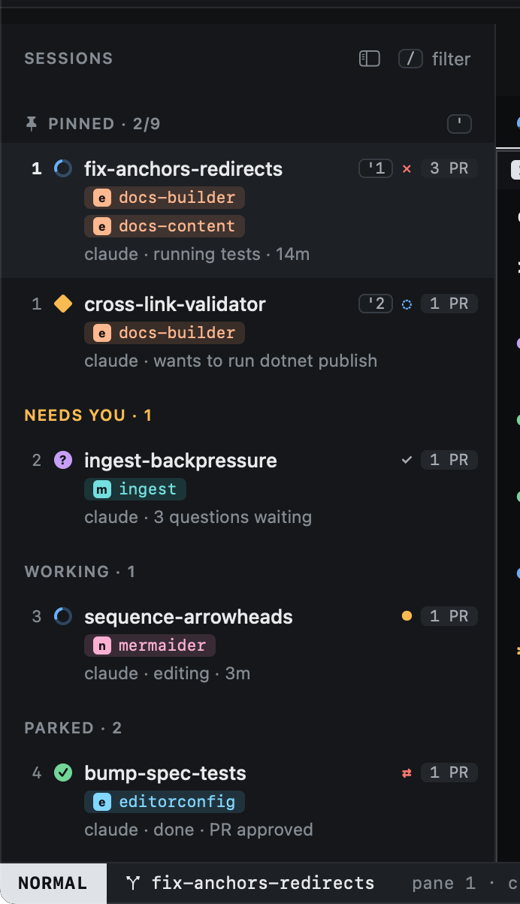
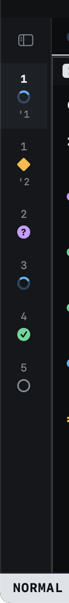

# The sidebar

The sidebar lists every open session, grouped so that whatever needs you is near the top.

| Group | Holds |
|---|---|
| **Pinned** | Sessions you pinned with `m`, in the order you pinned them. `'1` to `'9` jump to them. |
| **Needs you** | Blocked or asking: an agent waiting on you. |
| **Working** | Agents busy on their task. |
| **Parked** | Sessions you set aside with `zz`, and finished ones. |

Each row shows the session's state glyph, its worktree's name (hover it for the title from the prompt), its repos (one chip per worktree, then one per repo it opened a
PR in), the agent and what it is doing, how many pull requests it tracks, and the state of the most urgent one (see
[the state of a PR](../github/pr-overlay.md#the-state-of-a-pr)). The numbers on the left are relative to
the cursor, as in vim: the number on a row is how many `j` or `k` presses away it is.

Click a session to select it; double-click it to type into its agent (INSERT). Rows in the other lists (Inbox,
Issues, PRs, Repos, History) take clicks the same way: a click moves the cursor there, a double-click opens the
row as `↩` does.

The cursor stays on its session. When a session changes group (a parked agent starts working, or one starts asking),
the rows move but the selection does not, so what you are looking at, and typing into, never switches under you.

The footer counts repos and worktrees; `gr` opens [Repos](../worktrees/index.md).

## The rail

`zs` collapses the sidebar to a narrow rail: one row per session with its number, state and pin, so moving and jumping
still work. `zs` again brings the sidebar back.

