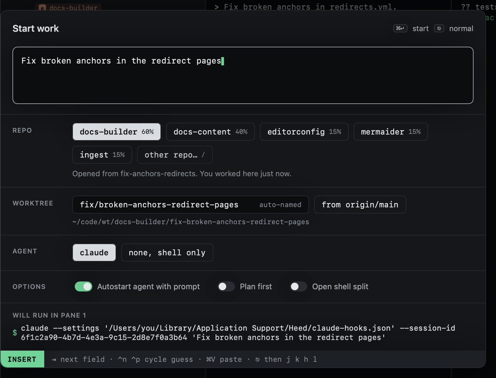

# Start work

`o` opens Start work. Describe the task; Heed picks the repo, names the branch, makes the worktree, opens a session and
starts the agent on your words.

The dialog has its own small modes, like Heed itself:

- **Typing** (INSERT, the default): keys go into the prompt or the worktree name. `⇥` moves to the next field.
- **Moving** (NORMAL, after `⎋`): `j` `k` or `⇥` move between fields, `h` `l` choose within one, `space` toggles,
  `i` or `↩` edits again.

| Key | |
|---|---|
| `⌘↩` | Start |
| `⌃n` / `⌃p` | Cycle the repo guess (or the agent, on the agent row) |
| `⌘V` | Paste into the prompt |
| `⎋` | Stop typing; again to cancel |

| Field | |
|---|---|
| **Prompt** | What you want done. It grows with what you type, up to a third of the window, then scrolls. |
| **Repo** | The guessed repo, and any others for a cross-repo session. See [Choosing repos](repos.md). |
| **Worktree** | The branch and folder name, from your first word. See [Branch names](branch-names.md). |
| **Agent** | Which agent starts, or a shell only. See [Agent and options](agent-and-options.md). |
| **Options** | Autostart, plan first, shell split. |

The bottom of the dialog shows the exact command the agent pane will run.

## Other ways in

- [From GitHub](from-github.md): `s` on issues or inbox items starts a session from them.
- [Starting again](again.md): `O` starts from a previous session's prompt.
