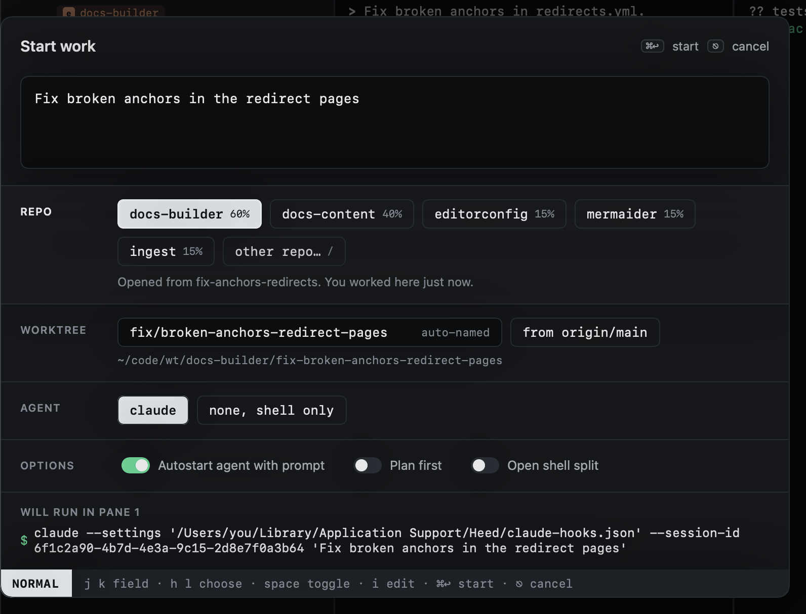
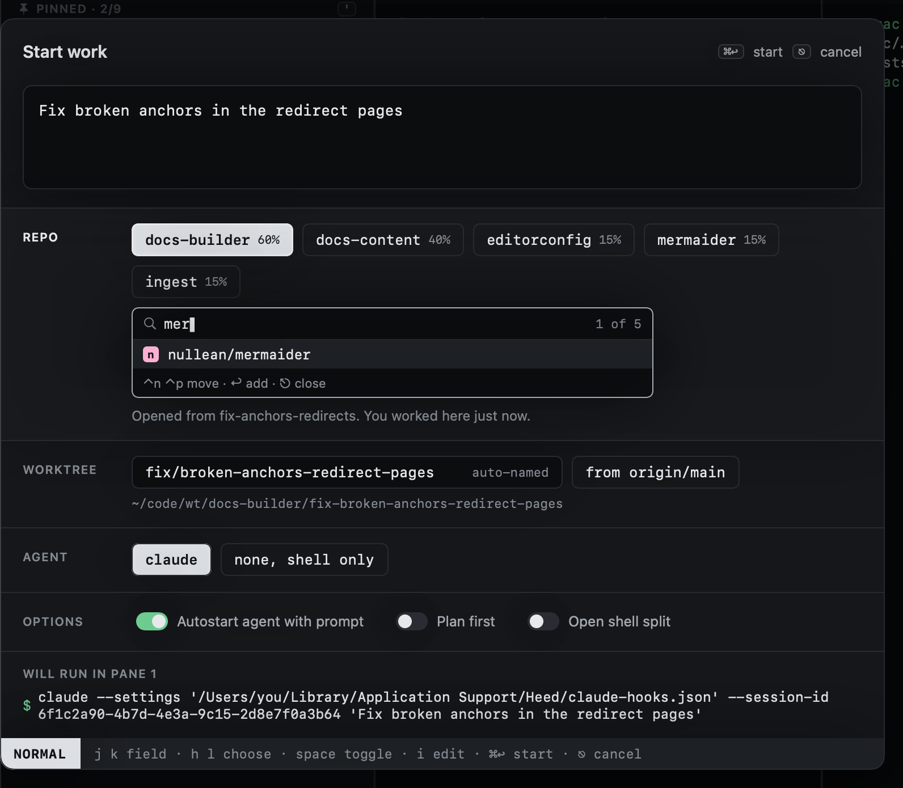

# Choosing repos

As you type, Heed ranks your repos and selects the best guess, only that one: each selected repo gets a worktree, so a
second is always yours to add. Each guess shows how sure it is, and the line under the
chips says why:

- **The prompt names it**: the strongest signal (`… in docs-builder`). Whole names only, and not inside a link or
  an `org/repo#12` reference: those point at an issue, not at where the work happens.
- **Words in common** with the repo's name.
- **Where you opened it**: the repos of the session under the cursor, or of the worktree, PR, issue or history
  entry. Strong, but a repo the prompt names still wins. Start work from anywhere (the global shortcut) has no cursor
  to go by.
- **How recently you worked there**: the last activity of its sessions, open or closed, counting for half as much
  every two days. Between equal guesses, the more recent repo comes first.

Move to the repo field (`⎋` then `j`) and use `h` `l` to move between chips and `space` to add or remove one. More than
one repo makes a cross-repo session: a worktree in each, on the same branch. `⌃n` `⌃p` cycle which one is primary.

## Any other repo

When none of the guesses is right, the last chip, **other repo…**, opens a search over every repo (or press `/` on the
repo field). Type to narrow, `⌃n` `⌃p` to move, `↩` to add it. It then keeps a chip of its own.

