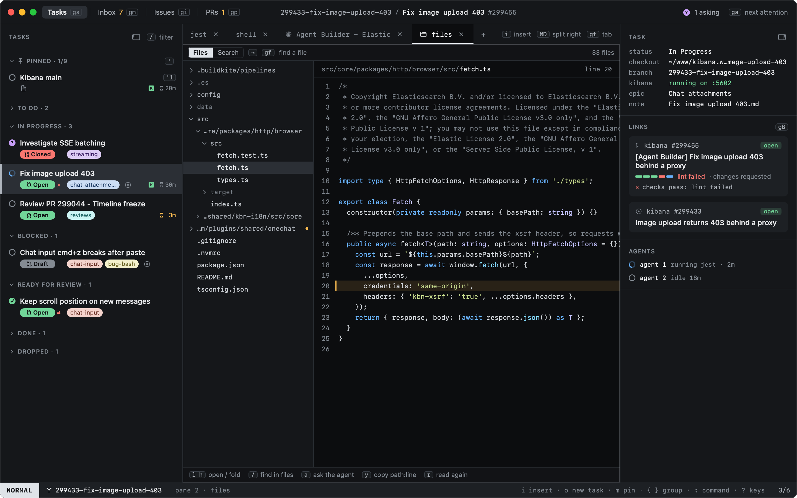
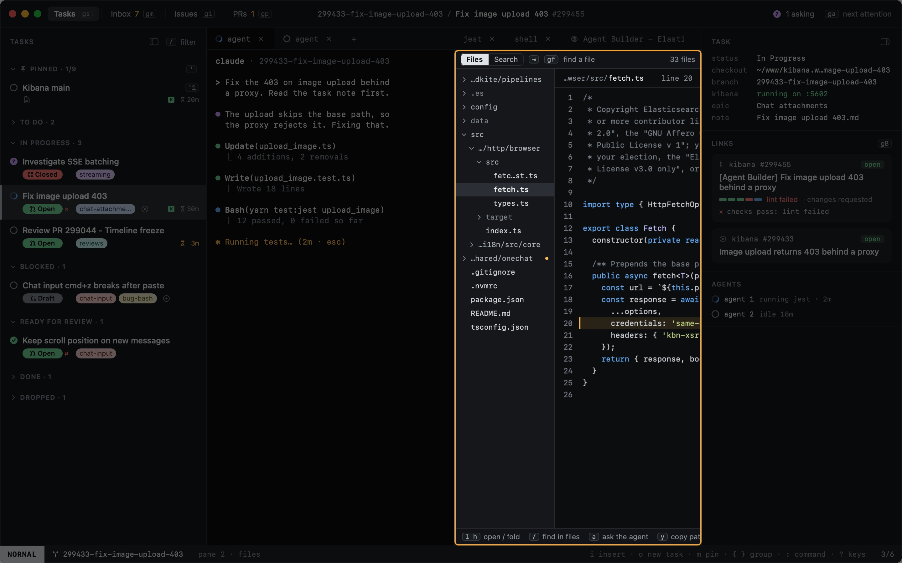
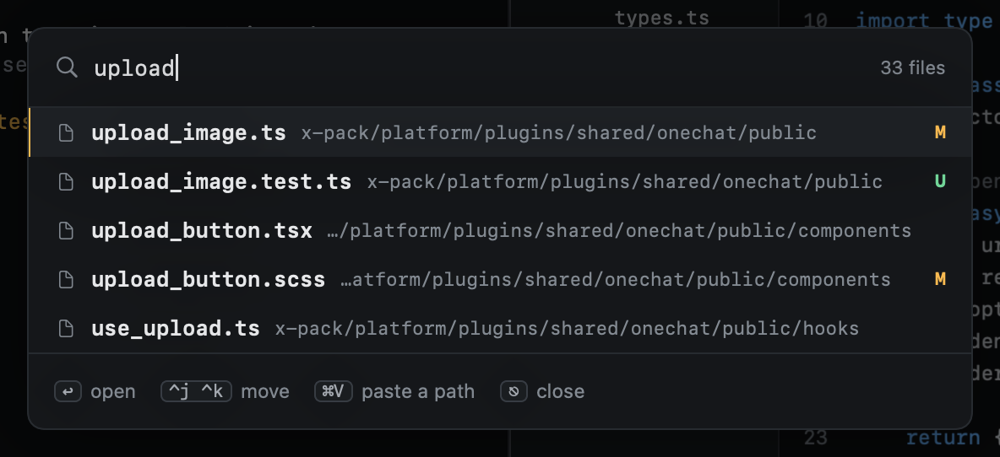
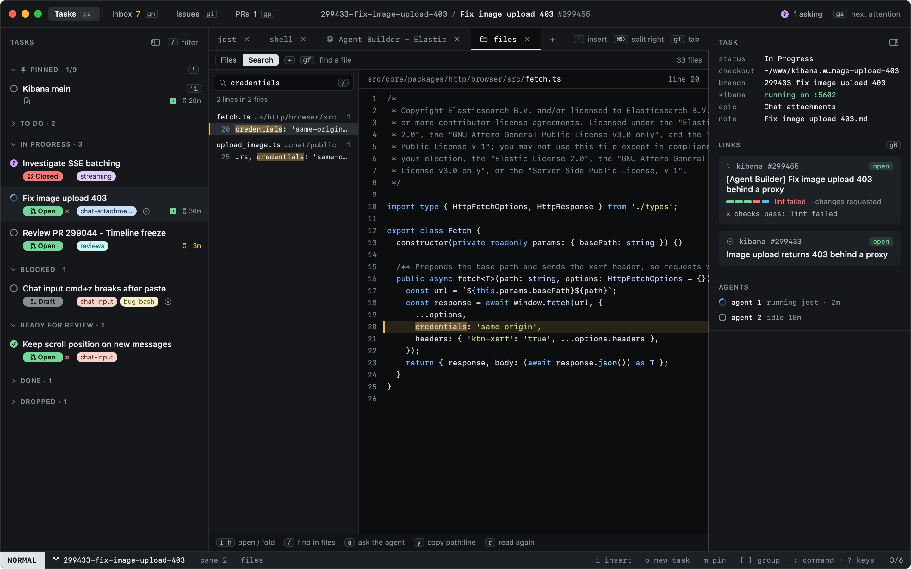

# Files

Each task has a **Files tab**: its checkout as a folder tree on the left, one file on the right, highlighted and read
only. Every "open this file" in Heed lands there, at the line: the file finder, `e` in the [Diff tab](../diff/index.md),
a `path:line` you `⌘`-click in a terminal. Nothing opens in another editor.

The tab opens in the work pane, beside the agent, like the Diff tab; a task has one, and a way in shows it when it is
there already. It stays with the task, and after a relaunch it comes back with the file it had open, read again when
you first show it.

## Opening a file

| Key | |
|---|---|
| `gf` | The file finder, from anywhere in the task (`p` in the Files tab) |
| `:files path[:line]` | That file, at that line |
| `:files`, `⌘T` then `f` | The tab; with the finder when no file is open in it |
| `e` in the Diff tab | The file you are on, at the line |
| `⌘`-click a path in a terminal | The file at its line, when the path is inside the task's checkout and the file exists |

A terminal's path can be absolute, `./`, `~/` or relative (`src/core/fetch.ts:20:7`); a relative one is taken from the
task's checkout, since Heed does not know a shell's current folder. An image opens in a [Viewer tab](viewer.md)
instead; other paths open in the app macOS picks for them.

## The file finder

`gf` lists every file of the checkout. Typing narrows it: each word matches the path in order, letters may be
skipped, and a match in the file's name, at the start of a word, or in a run ranks higher. The empty query lists the
files you opened in this tab, newest first, then the files git sees as changed.

Paste a path (`⌘V`), with or without `:line[:column]`: when it names a file of the checkout it is the first row, and
opens at that line. That works for a file the tree leaves out, such as one in `node_modules`.

| Key | |
|---|---|
| `↩` | Open the file the cursor is on |
| `⌃j` / `⌃k` (or `⌃n` / `⌃p`, `↓` / `↑`) | Move |
| `⌫`, `⌃w`, `⌃u` | Delete a letter, a word, everything |
| `⌘V` | Paste |
| `⎋` | Close |

The top 50 matches show. Matching runs beside the window, so typing never waits for it, even in Kibana's 134,000
files.

## The tree

Folders come first, then files, each by name. A folder with nothing but one folder in it shares its row
(`x-pack/platform/plugins`), so deep paths stay short. A changed file has git's mark (`M` modified, `A` added, `D`
deleted, `R` renamed, `U` untracked) and the folders it is in a dot. Opening a file shows where it is in the tree.

Git does not decide what shows: tracked, untracked and ignored files are all there, the ignored ones greyed, so
`config/kibana.dev.yml` and `.env` are a click away. A folder git ignores as a whole (`target`, `.es`, `data`) is read
when you open it. What matches `[files] exclude` in config.toml never shows (by default `node_modules`; patterns
match one part of the path, so `target` or `*.log`); neither does `.git`.

## Find in files

`/` searches every file of the checkout for what you type, with [ripgrep](https://github.com/BurntSushi/ripgrep)
(`brew install ripgrep`; `[tools] rg` points at another one). The search is literal, not a regular expression, and
ignores case unless the query has a capital letter. It skips what git ignores, `[files] exclude`, and files over 1 MB.

The search starts when you pause typing, and results come in as ripgrep finds them, grouped by file; typing again
stops it and starts over. `↩` searches at once and opens the first match; `⎋` stops typing and keeps the results. It
stops at 2,000 lines. The open file marks every place the query is in it.

`n` and `N` open the next and previous match, from one file into the next; `j` / `k` move in the results and `↩`
opens the one you are on. `⇥` goes back to the tree and returns to the same results.

## Keys

These keys work while the Files tab has the keys (NORMAL; the tab never takes INSERT, and you can select and copy
text with the mouse and `⌘C`). In the tab, `h` and `l` fold and open, so `⌃w h` and `⌃w l` leave it.

| Key | |
|---|---|
| `j` / `k` | Down / up the tree, or the results |
| `l` / `↩` | Open a file, unfold a folder (an open one: go into it), or open the match |
| `h` | Fold the folder, else go up to the folder you are in |
| `⌃d` / `⌃u` | Half a page down / up in the file |
| `gg` / `G` | The file's top / bottom |
| `p` | The file finder |
| `/` | Find in files |
| `⇥` | The tree, or the results |
| `n` / `N` | Next / previous match |
| `a` | Ask the agent: `About <path> around line <n>: ` is typed into the agent's pane, unsent, and you are in INSERT there |
| `y` | Copy `path:line` |
| `r` | Read the list and the file again |

## Staying current

The tab reads the file and the list again when you show it (when the last read is more than two seconds old), when
the task's agent finishes a turn, and on `r`; the file keeps its place. It does not watch the checkout, so a change
made in a shell shows the next time one of those happens.

A binary file, or one over 1 MB or 20,000 lines, gets a message instead of its text.
