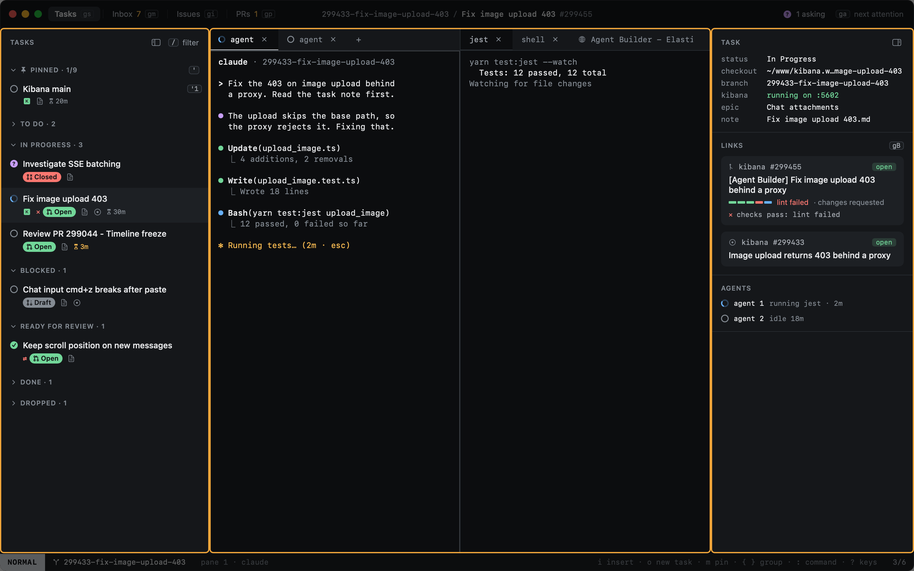

# Tasks

The Tasks view is where Heed opens (`gs` from anywhere). It has four parts.

1. **The sidebar**: every task, in a section per status (To Do, Done and Dropped collapsed). See
   [The sidebar](sidebar.md).
2. **The center**: the selected task's panes and their tabs, real terminals running its agents and anything else, and its
   web pages. See [Panes and tabs](panes-and-tabs.md) and [Web pages](web-pages.md).
3. **The inspector**: the task's checkout, Kibana, PR, issue and agents. See [The inspector](inspector.md).
4. **The status bar**: the mode, the branch, and the keys that matter in a dialog, a reader or a list (`?` lists
   them all).

Across the top, the title bar names the views with their keys, shows the task's title and PR (or the item under the
cursor) in the middle, and counts the agents waiting on you on the right.

## In this section

- [The sidebar](sidebar.md) · [New task](new-task.md) · [Status, worktrees and reviews](status-and-worktrees.md)
- [Moving around](moving-around.md) · [Typing into agents](typing-into-agents.md)
- [Panes and tabs](panes-and-tabs.md) · [Web pages](web-pages.md) · [Images](viewer.md) · [The inspector](inspector.md)
- [Pinning](pinning.md) · [Resuming tasks](resume.md) · [Agents that outlive Heed](zmx.md) · [Filtering](filtering.md)
