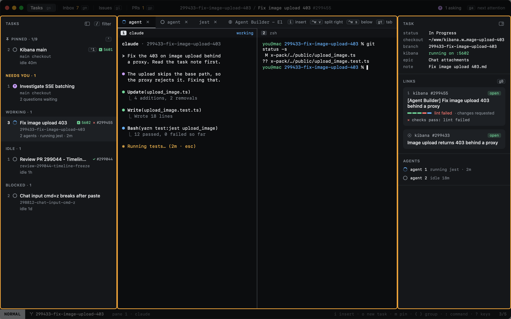

# Tasks

The Tasks view is where Heed opens (`gs` from anywhere). It has four parts.

1. **The sidebar**: every task in progress, grouped by what it needs from you. See [The sidebar](sidebar.md).
2. **The center**: the selected task's tabs and panes, real terminals running its agents and anything else.
   See [Panes and tabs](panes-and-tabs.md).
3. **The inspector**: the task's checkout, Kibana, PR, issue and agents. See [The inspector](inspector.md).
4. **The status bar**: the mode, the branch and pane, and the keys that matter right now.

Across the top, the title bar names the views with their keys, shows what you are looking at in the middle, and counts
the agents waiting on you on the right.

## In this section

- [The sidebar](sidebar.md) · [New task](new-task.md) · [Moving around](moving-around.md) · [Typing into agents](typing-into-agents.md)
- [Panes and tabs](panes-and-tabs.md) · [The inspector](inspector.md)
- [Pinning](pinning.md) · [Resuming tasks](resume.md) · [Agents that outlive Heed](zmx.md) · [Filtering](filtering.md)
