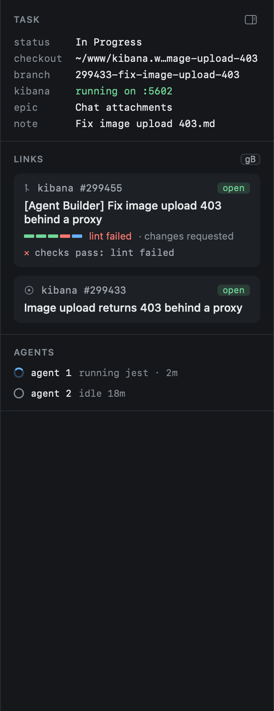
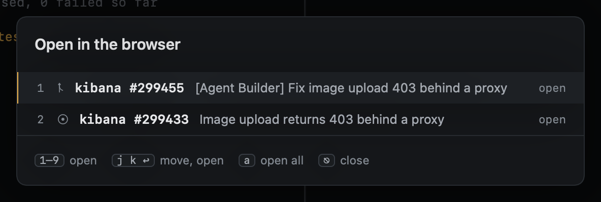

# The inspector

The inspector, on the right of the Tasks view, shows the selected task's surroundings.

- **Task**: its status, its checkout (the worktree, or `~/www/kibana`), the branch, whether Kibana runs and on which
  port, its epic and its note.
- **Links**: the task's PR, then its issue. The PR shows its checks bar, its review state, its
  [state](../github/pr-overlay.md#the-state-of-a-pr), and the first green rule holding it back. A merged or closed PR
  keeps its checks as they finished and says it is done. The issue shows its title and whether it is open.
- **Agents**: each agent tab with its state and what it is doing. Under each, the latest states it reported, newest
  first. A turn's working steps show while it runs and fold away once it ends, leaving how it ended.

## Links

**Click a link** to open it here: the PR in the [PR overlay](../github/pr-overlay.md), the issue in the
[reader](../github/reading.md). **⌘-click** opens it on GitHub. `go` opens the PR overlay from the keyboard.

A task's PR and issue are set by the agent: its `gh pr create` sets the PR, and `heed pr add <url>` or
`heed issue add <url>` set either by hand. See [A task's PR](../github/task-prs.md).

With no PR and no issue yet, the inspector says what comes next. A pushed branch offers **Open a PR on GitHub**, the
compare page for the branch.

### Opening them in the browser

| Key | |
|---|---|
| `gB` | One link opens it. Several open a picker: `1`–`9` opens one, `j` `k` `↩` too, `a` opens all, `⎋` closes. None opens the repo. |
| `gR` | Kibana on GitHub |

In the other views `gB` opens the item under the cursor and `gR` its repo.

`zi` collapses and expands the inspector. It also gives way first when the window is narrow.
