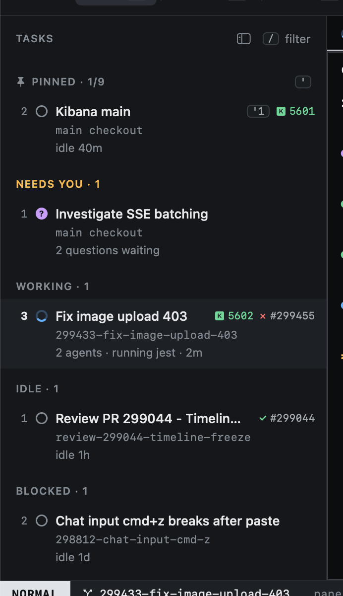
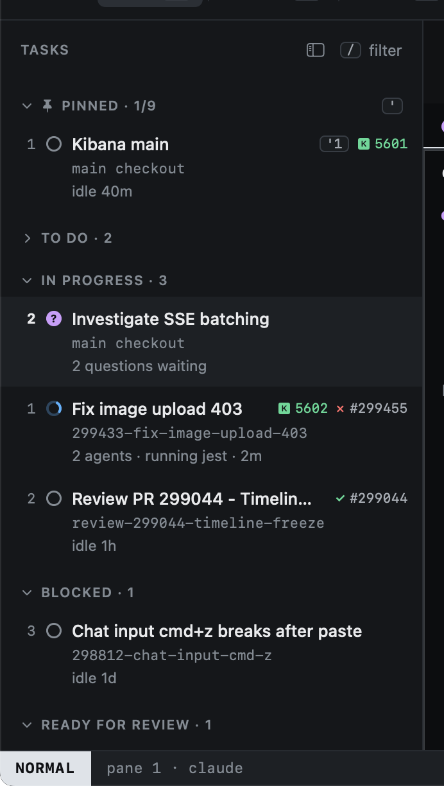

# Moving around

Moving between tasks works like moving in vim.

| Key | Moves to |
|---|---|
| `j` / `k` | The next / previous task (also `↓` / `↑`) |
| `gg` / `G` | The first / last task |
| `3j` | Three tasks down: a count repeats any move |
| `{` / `}` | The previous / next group |
| `ga` | The next task that needs you (an agent blocked or asking) |
| `''` | The task you were on before |
| `'1` … `'9` | Pinned task 1 to 9 |
| `:task <words>` | The first task matching the words (a matching To Do task is set In Progress) |

Clicking a task selects it too. [Hints](../keyboard/hints.md) (`f`) jump to any task or pane by label.

`ga` is the key to remember: it always takes you to whoever is waiting, wherever you are.

