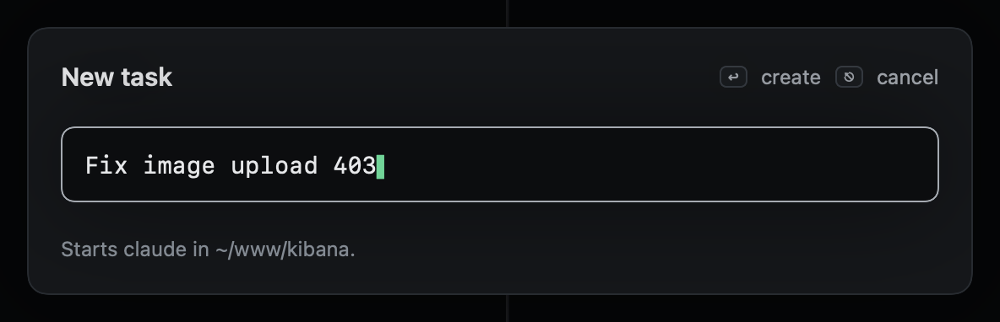
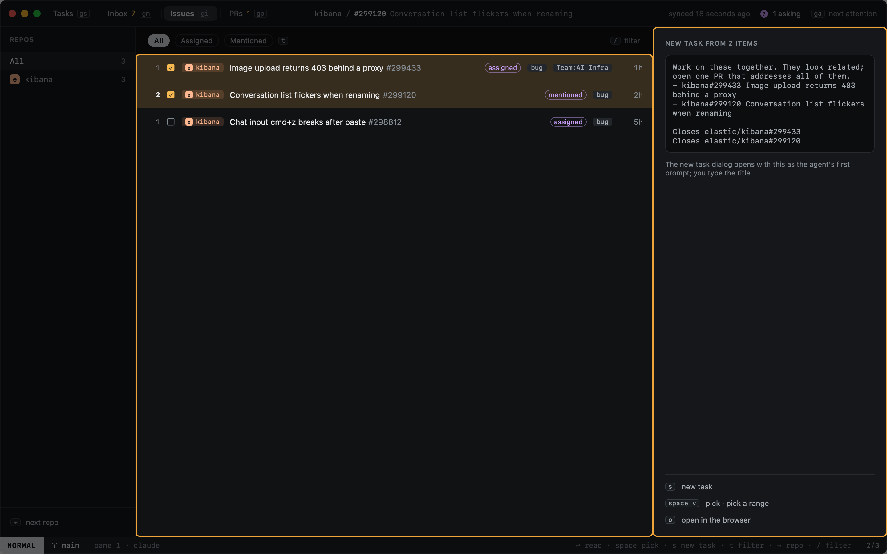
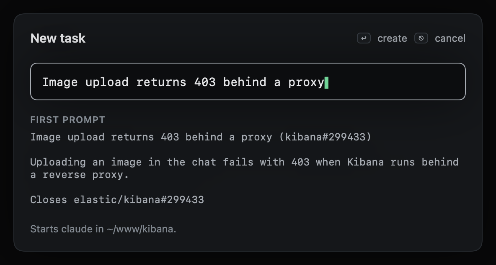

# New task

`o` (or `:new <title>`) opens the New task dialog. It asks for one thing: a title. `↩` has pk write the task's note,
In Progress, and starts claude on it in the main Kibana checkout, `~/www/kibana`, with its own Claude session. When
it needs a branch, `W` gives it a worktree (see [Status, worktrees and reviews](status-and-worktrees.md)).

| Key | |
|---|---|
| `↩` or `⌘↩` | Create the task |
| `⎋` | Cancel |
| `⌘V` | Paste into the title (on one line) |
| `⌥⌫` or `⌃w` | Delete the last word |
| `⌃u` | Clear the title |

An empty title is not created: the dialog says "type a title first".

`shell_split` under `[sessions]` in config opens a shell beside the agent. Without claude, the task opens a shell
only.

## From GitHub

In Inbox or Issues, pick rows with `space` (or `v`), then press `s`: the New task dialog opens with their title, and
the agent's first prompt is made from them. In the PR reader, `S` does the same for that PR.

