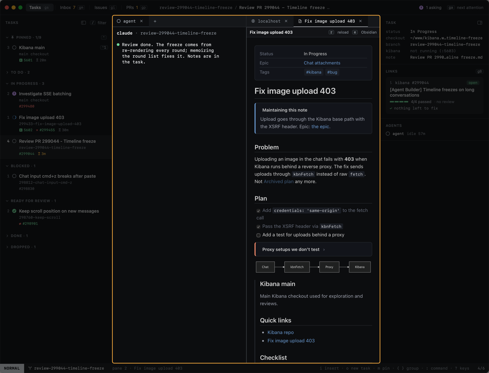
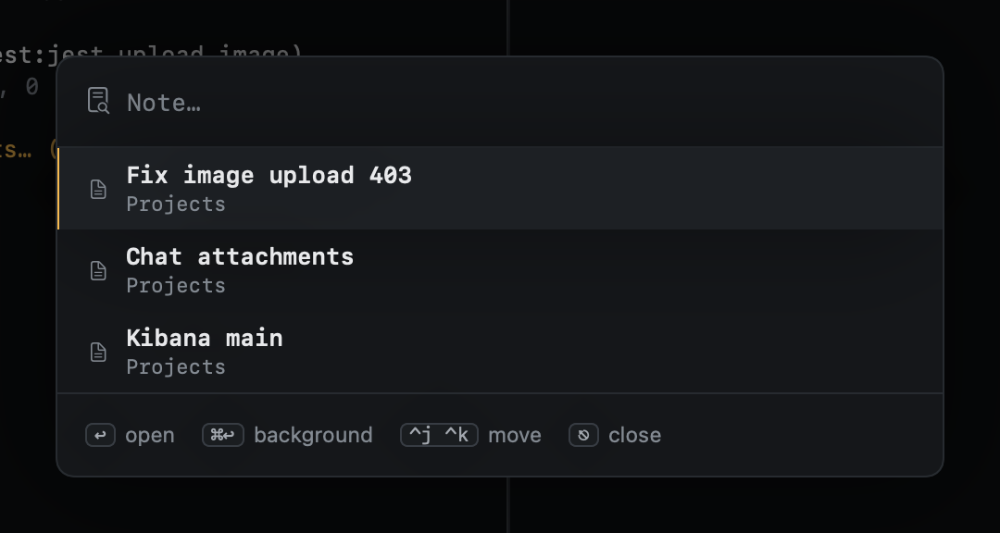
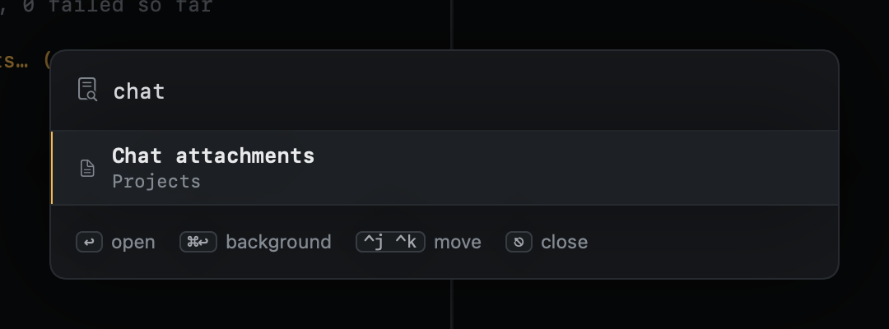

# Notes

Heed can open notes from your Obsidian vault as read-only tabs inside a task. A note tab sits in the work pane beside
the agent, stays with the task across relaunches, and updates live when the file changes on disk.

## Opening a note

| Key | |
|---|---|
| `gN` | Open the note picker |
| `⌘T` then `n` | A new note tab from the ⌘T dialog |
| `:note [words]` | Open the picker, or the note directly when the query matches exactly one |

The picker fuzzy-searches your whole vault. The empty list shows the current task's note first, then its epic, then
everything else sorted by last-modified. Typing narrows by name, alias, and folder; each word matches on its own, in
any order. The same note can be open in several tasks, one tab in each.

Inside the picker:

| Key | |
|---|---|
| `⌃j` / `⌃k`, `⌃n` / `⌃p`, `↓` / `↑` | Move down and up (plain letters go into the search) |
| `↩` | Open the selected note |
| `⌘↩` | Open in the background |
| `⌃w` | Drop the last word |
| `⌫` | Delete the last character |
| `⎋` | Close without opening |

## Note scope keys

When a note tab is focused in NORMAL mode, these keys are active:

| Key | |
|---|---|
| `j` / `k`, `↓` / `↑` | Scroll down / up a few lines |
| `⌃d` / `⌃u` | Scroll down / up half a page |
| `gg` | Scroll to the top |
| `G` | Scroll to the bottom |
| `e` | Open the note in Obsidian |
| `y` | Copy the note's absolute path |
| `r` | Reload the note from disk |

## Wikilinks

Links written as `[[Note name]]` resolve to other notes in your vault. Click one to navigate to that note in place;
`⌘`-click to open it as a new tab. Wikilinks that cannot be resolved are shown dimmed.

## Live reload

When a note file changes on disk (an agent edited it), Heed re-reads and re-renders it, keeping the current scroll
position. A note tab in another task reads the note again when it is next shown.

## Obsidian features rendered

Notes are read only: `e` opens the note in Obsidian to edit it. Bases, Dataview and other community plugins are not
rendered.

- Frontmatter YAML shown as a properties table
- Callouts (`> [!note] Title`, `> [!warning]`, etc.), foldable ones (`> [!tip]-`) closed until clicked
- Embedded notes (`![[Note name]]`, one level deep) and images from the vault (`![[Pasted image.png]]`, found by name
  anywhere in the vault as Obsidian does, and ``)
- Task lists (`- [ ]` / `- [x]`)
- Wikilinks (`[[Note name]]`, `[[Note name|Alias]]`, `[[Note name#Heading]]`)
- Highlighted text (`==like this==`)
- Comments (`%% hidden %%`)
- Tags (`#tag`)
- Footnotes
- Fenced code blocks with syntax highlighting (TypeScript, JavaScript, JSON, Bash, YAML, Swift, Python, CSS, Markdown, Diff)
- Mermaid diagrams (loaded lazily; rendered only when a note contains a mermaid block)

## Configuration

The vault path comes from your `pk` configuration. If `pk` is not configured, note tabs are not available.
