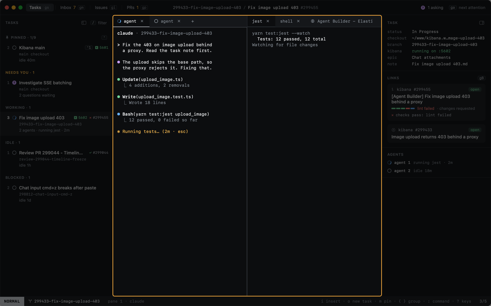

# Panes and tabs

A task's window area is split into panes, and each pane has its own tabs. A tab shows one thing: an agent, a shell, a
pinned command or a [web page](web-pages.md). The agent sits in a pane on the left and everything else opens in the
pane on its right, so the agent stays in view while you switch what the other pane shows. Pane keys start with `⌃w`,
as in vim.

| Key | |
|---|---|
| `⌃w v` | New pane on the right, with a shell |
| `⌃w s` | New pane below, with a shell |
| `⌃w h` `⌃w j` `⌃w k` `⌃w l` | Focus the pane left, below, above, right (`h` and `l` alone work too) |
| `⌃w z` | Zoom the focused pane (again to unzoom) |
| `⌃w q` | Close the focused pane; its tabs join the pane beside it, so nothing stops |
| `gt` / `gT` | Next / previous tab of the focused pane (also `⌘⇧]` / `⌘⇧[`, in INSERT too) |
| `gn` | New tab with a shell in the focused pane (or click a pane's `+`) |
| `gc` | The task's agent: to its tab; when it was closed, it comes back with its conversation; else a new agent |
| `:tab.close` | Close the focused pane's tab (or click its `×`, or `⌘W` on a page); the agent's tab asks first |




Where a new tab goes:

- A shell, a page, Kibana or a pinned command opens in the work pane: the focused pane if it has no agent, else the
  first pane without one. When every pane has an agent, a new pane opens on the right of the agent's.
- An agent opens in the agent's pane. When that pane was closed, the agent comes back in a new pane on the left.
- `gn`, `⌃w v` and `⌃w s` put the shell where you asked.

A task can have several agent tabs. Each has its own glyph in the tab strip, its own state and its own Claude session.

Drag a divider between panes to resize them; each task's panes keep their sizes across relaunches. The sidebar's and
the inspector's edges drag too; their widths are the same for every task. Drag a tab along a strip to move it, or onto
another pane's strip to move it there; a pane whose last tab leaves closes.

The top right pane's strip shows the keys that matter where you are looking, as you have them bound: in NORMAL, `i`
to type into the pane, the split and the next tab; in INSERT, how to get back out. A narrow pane leaves them out; the
status bar has them too.


## When terminals end

A tab closes when its terminal ends: `exit` or `⌃D` in a shell, or a command that finishes. The last tab of a pane
takes the pane with it.

When a task has no terminal left, whether by `exit` or `×`, the task stays where it is, and `gn` opens a
shell in its checkout. A task ends through its status, not by closing its terminals. `gc` brings back the agent
closed last: Claude resumes its conversation in the folder it worked in.

Terminals that end together across several tasks were lost, not closed (heed quitting, or being replaced while it
runs), and no task is touched: they reopen on the next launch. The same goes for every terminal while heed quits.

New tasks open with the agent alone; set `shell_split = true` under `[sessions]` for a shell in a pane beside it.

## Pinned commands

Commands you run in every worktree, such as tests, live under `[commands]` in config. Each opens as a tab of its own in
the work pane, running its command, when a task gets a worktree. The tab's glyph shows the last run: done when it passed, a red
square when it failed.

```toml
[commands]
jest = "yarn test:jest x-pack/platform/plugins/shared/onechat"
```

## Zoom


