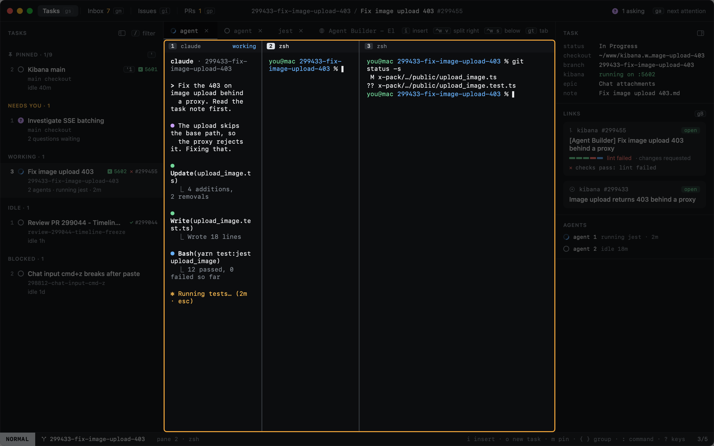
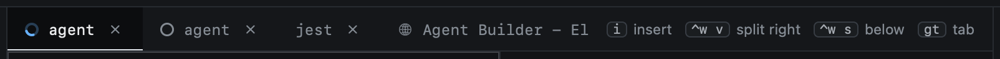
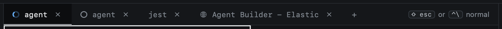
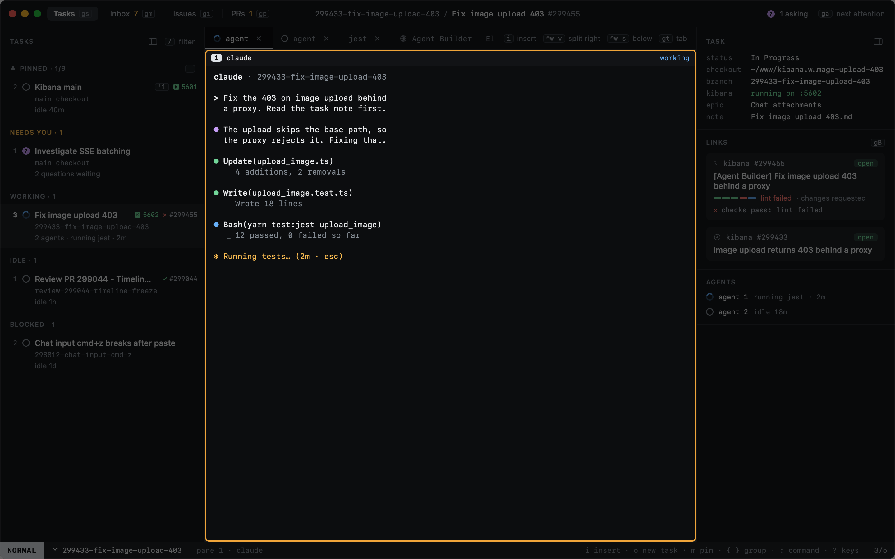

# Panes and tabs

A task's terminals are panes, arranged in tabs. So are its [web pages](web-pages.md). Pane keys start with `⌃w`, as in
vim.

| Key | |
|---|---|
| `⌃w v` | Split right |
| `⌃w s` | Split below |
| `⌃w h` `⌃w j` `⌃w k` `⌃w l` | Focus the pane left, below, above, right (`h` and `l` alone work too) |
| `⌃w z` | Zoom the focused pane (again to unzoom) |
| `⌃w q` | Close the focused pane; an agent's pane asks first |
| `gt` / `gT` | Next / previous tab |
| `gn` | New tab with a shell (or click `+`) |
| `:tab.close` | Close the tab and every pane in it (or click its `×`); a tab with an agent asks first |





A task can have several agent tabs. Each has its own glyph in the tab strip, its own state and its own Claude session.

The right of the tab strip shows the keys that matter where you are looking, as you have them bound: in NORMAL,
`i` to type into the pane, the splits and the next tab; in INSERT, how to get back out.



## When terminals end

A pane closes when its terminal ends: `exit` or `⌃D` in a shell, or a command that finishes. The last pane of a tab
takes the tab with it.

When a task has no terminal left, whether by `exit`, `×` or `⌃w q`, the task stays where it is, and `gn` opens a
shell in its checkout. A task ends through its status, not by closing its terminals.

Terminals that end together across several tasks were lost, not closed (heed quitting, or being replaced while it
runs), and no task is touched: they reopen on the next launch. The same goes for every terminal while heed quits.

New tasks open with the agent alone; set `shell_split = true` under `[sessions]` for a shell beside it.

## Pinned commands

Commands you run in every worktree, such as tests, live under `[commands]` in config. Each opens as a tab of its own,
running its command, when a task gets a worktree. The tab's glyph shows the last run: done when it passed, a red
square when it failed.

```toml
[commands]
jest = "yarn test:jest x-pack/platform/plugins/shared/onechat"
```

## Zoom


