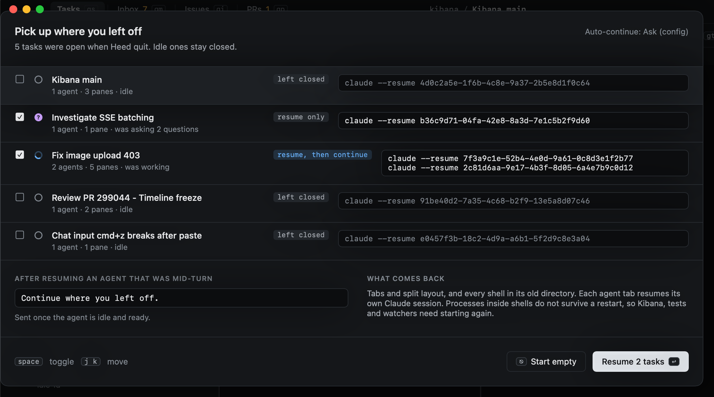

# Resuming tasks

When Heed starts, the tasks' tabs and panes come back. (With `persist = "zmx"` their agents never stopped, and
their panes reattach instead: see [Agents that outlive Heed](zmx.md).) Whether their agents resume is up to `resume_on_launch`
under `[sessions]`:

| Value | On launch |
|---|---|
| `ask` | List the tasks with agents and let you pick which to resume (the default) |
| `always` | Resume them all |
| `never` | Open plain shells; resume by hand |

Each agent tab has its own Claude session id, given at launch (`claude --session-id <id>`). Resuming uses it
(`claude --resume <id>`), tab by tab, so a task with two agents gets both back. If Claude no longer has a tab's
session, Heed says so and starts that agent fresh, pointed at the task note.

## The continue prompt

An agent that was mid-turn when Heed quit gets a nudge once its agent is idle again: `continue_prompt`, by default
"Continue where you left off.". Set it to `""` to turn it off.
