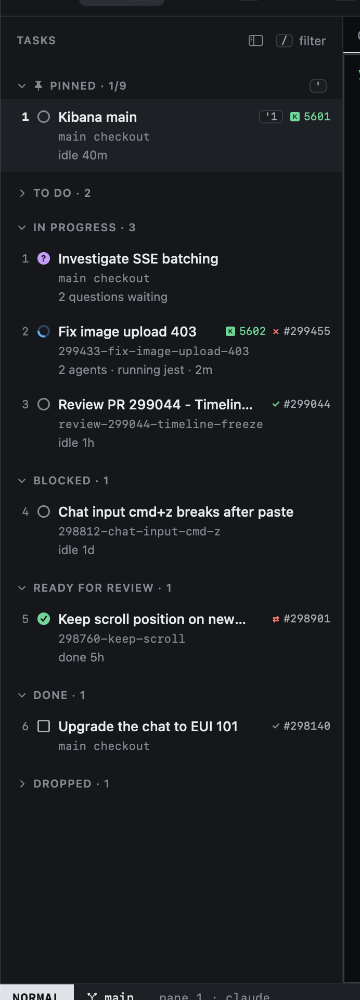

# The sidebar

The sidebar lists every task, in one section per status, in the Kanban's order.

| Section | Holds | Starts |
|---|---|---|
| **Pinned** | Tasks you pinned with `m`, whatever their status, by title. `'1` to `'9` jump to them. | open |
| **To Do** | Not started yet. | collapsed |
| **In Progress** | Being worked on. | open |
| **Blocked** | Waiting on something outside Heed. | open |
| **Ready for Review** | Waiting for a review. An In Progress task moves here by itself when its PR is opened for review ([how](status-and-worktrees.md#ready-for-review-by-itself)). | open |
| **Done** | Finished. | collapsed |
| **Dropped** | Given up. | collapsed |

A pinned task shows only under Pinned. A note with a status pk does not know is listed under **Other**. Sections with no
tasks are left out. Inside a section, the most recently active task comes first; the row's glyph shows what its agent
is doing.

A task whose status changes, in Heed or outside it (Obsidian, an agent, a cron job), moves to its new section. Its
tabs, terminals and agents stay as they were.

## Collapsing sections

Click a section's header, or press `za` on a task, to collapse or expand its section. `:section done` (any status name
`:status` takes, or `pinned`) does it by name. A collapsed section shows its name and how many tasks it has; `j` `k`,
`gg` `G`, `{` `}`, counts and the line numbers skip its rows. Heed remembers which sections are collapsed across
relaunches.

Going to a task in a collapsed section (`'1`, `ga`, `''`, `:task`, a PR's task, the menu bar) opens that section.
Collapsing the section the cursor is in moves the cursor to the next row below it, or the nearest one above.

Each row shows:

- The state glyph of the task's most urgent agent.
- The title, and the pin number if pinned.
- A Kibana icon with the port, when Kibana runs for the task.
- The PR's state and number (see [the state of a PR](../github/pr-overlay.md#the-state-of-a-pr)).
- The worktree's name, or "main checkout".
- What the agent is doing. With more than one agent tab, how many ("2 agents · running jest").

The numbers on the left are relative to the cursor, as in vim: the number on a row is how many `j` or `k` presses
away it is.

Click a task to select it; double-click it to type into its agent (INSERT). Rows in the other lists (Inbox, Issues,
PRs) take clicks the same way: a click moves the cursor there, a double-click opens the row as `↩` does.

The cursor stays on its task. When the task changes section, the rows move but the selection does not, so what you
are looking at, and typing into, never switches under you. When it moves into a collapsed section (an agent marks it
Done, say) and still has tabs, that section opens so its agent stays in front of you. A task with no tabs leaves the
section collapsed, and the cursor goes to the next row.

## The rail

`zs` collapses the sidebar to a narrow rail: one row per task of the open sections, with its number, state and pin,
and a short line where a section starts. These are the rows the cursor walks, so moving and jumping work as in the
sidebar. `zs` again brings the sidebar back.

