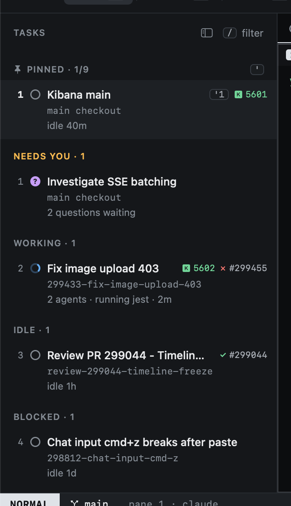
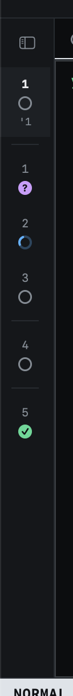

# The sidebar

The sidebar lists every task in progress, grouped so that whatever needs you is near the top.

| Group | Holds |
|---|---|
| **Pinned** | Tasks you pinned with `m`, by title. `'1` to `'9` jump to them. |
| **Needs you** | An agent blocked or asking: waiting on you. |
| **Working** | An agent busy on the task. |
| **Idle** | Agents waiting for a prompt, finished, or no agent at all. |
| **Blocked** | The task's status is Blocked: it waits on something outside Heed. |

In Progress and Blocked tasks are listed, plus pinned ones whatever their status. To Do tasks stay on the Kanban, and
Done ones are not listed. Inside a group, the most recently active task comes first.

Each row shows:

- The state glyph of the task's most urgent agent.
- The title, and the pin number if pinned.
- A Kibana icon with the port, when Kibana runs for the task.
- The PR's state and number (see [the state of a PR](../github/pr-overlay.md#the-state-of-a-pr)).
- The worktree's name, or "main checkout".
- What the agent is doing. With more than one agent tab, how many ("2 agents · running jest").

The numbers on the left are relative to the cursor, as in vim: the number on a row is how many `j` or `k` presses
away it is.

Click a task to select it; double-click it to type into its agent (INSERT). Rows in the other lists (Inbox, Issues,
PRs) take clicks the same way: a click moves the cursor there, a double-click opens the row as `↩` does.

The cursor stays on its task. When a task changes group (an idle agent starts working, or one starts asking), the rows
move but the selection does not, so what you are looking at, and typing into, never switches under you.

## The rail

`zs` collapses the sidebar to a narrow rail: one row per task with its number, state and pin, so moving and jumping
still work. `zs` again brings the sidebar back.

