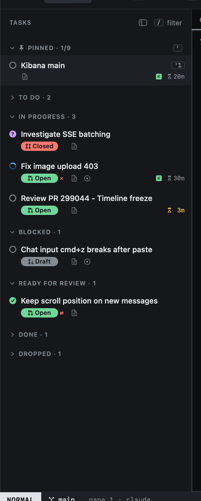
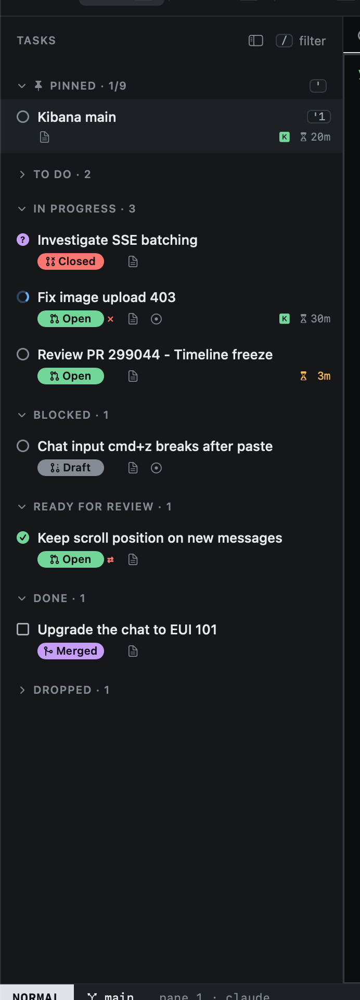
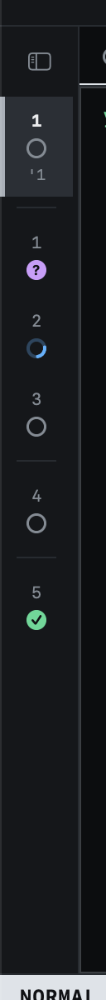

# The sidebar

The sidebar lists every task, in one section per status, in the Kanban's order.

| Section | Holds | Starts |
|---|---|---|
| **Pinned** | Tasks you pinned with `m`, whatever their status, by title. `'1` to `'9` jump to them. | open |
| **To Do** | Not started yet. | collapsed |
| **In Progress** | Being worked on. | open |
| **Blocked** | Waiting on something outside Heed. | open |
| **Ready for Review** | Waiting for a review. An In Progress task moves here by itself when its PR is opened for review ([how](status-and-worktrees.md#ready-for-review-by-itself)). | open |
| **Done** | Finished. | collapsed |
| **Dropped** | Given up. | collapsed |

A pinned task shows only under Pinned. A note with a status pk does not know is listed under **Other**. Sections with no
tasks are left out. Inside a section, the most recently active task comes first; the row's glyph shows what its agent
is doing.

A task whose status changes, in Heed or outside it (Obsidian, an agent, a cron job), moves to its new section. Its
tabs, terminals and agents stay as they were.

## Collapsing sections

Click a section's header, or press `za` on a task, to collapse or expand its section. `:section done` (any status name
`:status` takes, or `pinned`) does it by name. A collapsed section shows its name and how many tasks it has; `j` `k`,
`gg` `G`, `{` `}`, counts and the rail's numbers skip its rows. Heed remembers which sections are collapsed across
relaunches.

Going to a task in a collapsed section (`'1`, `ga`, `''`, `:task`, a PR's task, the menu bar) opens that section.
Collapsing the section the cursor is in moves the cursor to the next row below it, or the nearest one above.

## A row

Each row shows:

- The state glyph of the task's most urgent agent.
- The title, and the pin number if pinned.
- Its tags, when it has any (a task with none has no second line). Each keeps its place, so they line up down the
  list. On the left:
  - The PR's state, as GitHub labels it: green Open, grey Draft, violet Merged, red Closed. After it, the PR's mark
    when there is something to act on: ✕ a check failed, ⇄ a conflict (or behind), ● open threads or changes
    requested (see [the state of a PR](../github/pr-overlay.md#the-state-of-a-pr)). Hover it for the number; click it
    for the PR's page in [the PR panel](../github/pr-page.md), and again to hide it.
  - The task's note, shown as its tags (the note's `tags:`), each a pill in the colour Obsidian's Kanban gives it
    (the vault's Tag Colors plugin; a tag Obsidian has not coloured yet is grey), or as a note icon when it has no
    tags. Click it to open the note as a tab of the task. When the row is short of room, the tags are cut first.
  - The task's issue, when its note has one: click it to open the issue as a new page in the task.

  On the right, what is running:
  - A green K when Kibana runs for the task. Hover it for the port; click it to open Kibana as a new page in the
    task.
  - An hourglass with the minutes left on the agent's prompt cache, amber in the last five. Click it to keep the
    cache warm ([below](#keep-cache-warm)); while that is on, a flame on an orange pill.

Hover a row for what its agent is doing; with more than one agent tab, how many ("2 agents · running jest").

Click a task to select it; double-click it to type into its agent (INSERT). Rows in the other lists (Inbox, Issues,
PRs) take clicks the same way: a click moves the cursor there, a double-click opens the row as `↩` does.

Right-click a task (or ⌃-click it), in the sidebar or the rail, for its menu. It selects the task first, as a click
does. **Pull request** (when it has one) opens [the PR panel](../github/pr-page.md). **Keep cache warm** (when it
has an agent) turns [keep cache warm](#keep-cache-warm) on or off, checked while on; it is greyed while there is no
cache to keep. **Status** lists every status,
the task's own checked, each with its key; picking one does what that key does
([Status](status-and-worktrees.md#status)), so Done and Dropped ask first.

The cursor stays on its task. When the task changes section, the rows move but the selection does not, so what you
are looking at, and typing into, never switches under you. When it moves into a collapsed section (an agent marks it
Done, say) and still has tabs, that section opens so its agent stays in front of you. A task with no tabs leaves the
section collapsed, and the cursor goes to the next row.

### The prompt cache countdown

Claude keeps a prompt cache for an hour after the agent's last response: a prompt sent within that hour is cheaper
and faster. The countdown starts when the agent's turn ends, so 15 minutes after it the tag says `45m`. It stays
while the agent works or waits on you, and starts again when the next turn ends; it is gone once the hour is up.
It is the task's own agent's: its first agent tab, the one `gc` goes to. Resuming an agent (after a relaunch, or
with `gc` after its tab was closed) keeps the countdown of its last turn; a new, cleared or compacted conversation
has none until its first turn ends.

### Keep cache warm

Click the countdown (or pick **Keep cache warm** in the task's menu, or type `:keepwarm`) and Heed keeps the
agent's cache from running out: 55 minutes after the cache's start it pings the agent's Claude session, and on a hit
the countdown goes back to `60m`. The ping is a separate headless Claude (`claude -p --resume <session>
--no-session-persistence --model <the session's model>`) in the agent's folder: nothing is typed into the tab, and
the session file is not touched. A hit costs about a twentieth of rebuilding the cache (measured: $0.04 on a 77k
Opus context). Hover the flame for the last ping: when, how much it read from the cache, and what it cost.

It never pings a cache that may be gone: not after 58 minutes (the countdown starts at the turn's end, a little
after Claude refreshed the cache), and not while the agent works or waits on you, since its turn will start the
hour again anyway. It turns off, saying why in the status bar and the task's timeline, when the cache expired (a
Mac asleep through the ping, too), when a ping misses the cache or fails, when the agent's tab is closed, and at
the day's cut-off: `[keepwarm] until` in config.toml, `17:00` by default. `:keepwarm on` and `:keepwarm off` set it
either way.

## The rail

`zs` collapses the sidebar to a narrow rail: one row per task of the open sections, with its number, state and pin,
and a short line where a section starts. The numbers are relative to the cursor, as in vim: the number on a row is
how many `j` or `k` presses away it is. These are the rows the cursor walks, so moving and jumping work as in the
sidebar. `zs` again brings the sidebar back.

