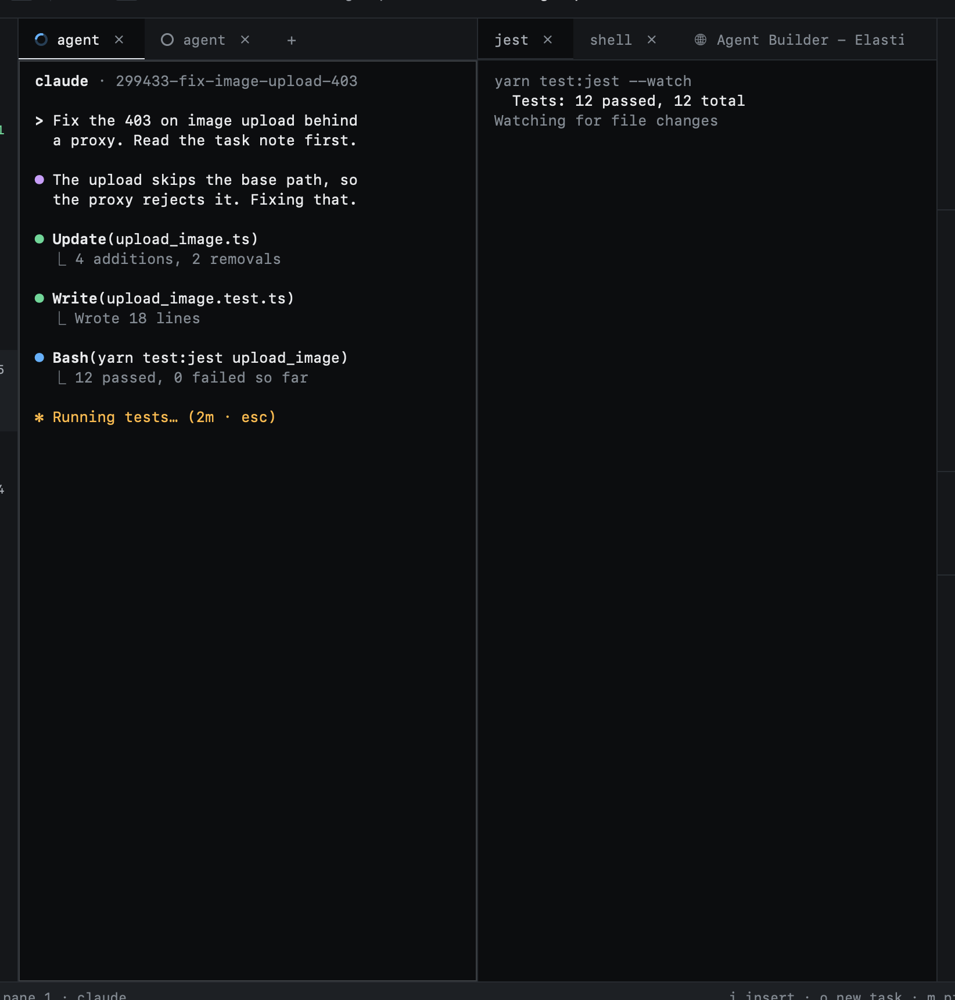
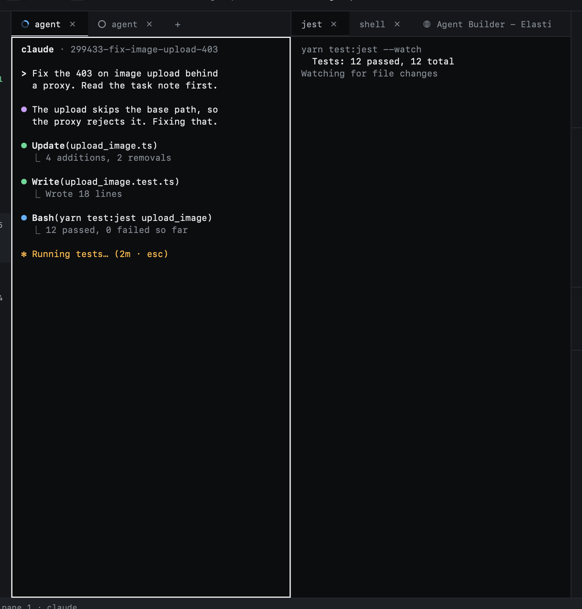

# Typing into agents

In NORMAL your keys drive Heed and never reach a terminal. To type into one, enter INSERT.

| Key | |
|---|---|
| `i` | INSERT on the focused pane |
| `F` | Jump to a pane by label and enter INSERT on it |
| `⇧⎋` | Back to NORMAL |
| `⌃\` | Back to NORMAL (configurable as `insert_escape`) |

A plain `⎋` always goes to the terminal, so agents still get their Escape.

The pane taking your keys has a white border. In NORMAL no pane takes input, and the focused one is barely marked: if
you see no white border, your keys are Heed's.

## With the mouse

Clicking a pane focuses it and enters INSERT; clicking anywhere else (the sidebar, a list, the title bar) goes back to
NORMAL. A double click selects a word in the terminal, as it does in any terminal.

## Starting in INSERT

A new task starts with its agent pane focused and in INSERT, so you can type to the agent straight away. Going to a
tab (`gt`, `gT`, `gn`, `:tab.go`, or a click on it) does the same when the tab is a terminal: it takes your keys.
