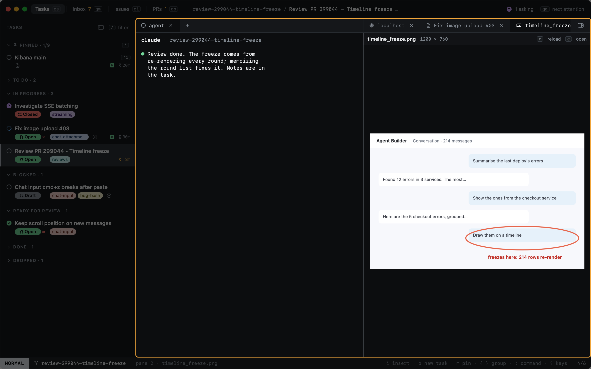

# Images

`⌘`-click the path of an image in a terminal (a screenshot an agent left in its scratchpad, say) and it opens in a
**Viewer tab** of that task, next to the tab you clicked in, instead of in Preview. Each image has its own tab, so you
can keep several open; `⌘`-clicking one that is open already goes to its tab and reads it again.

The path can be absolute, `./`, `~/`, `file://` or relative to the task's checkout, inside the checkout or anywhere
else. Heed shows PNG, JPEG, GIF, WebP, HEIC, TIFF and the other images macOS reads itself; an SVG, a PDF or any other
file opens in the app macOS picks for it, as before. When nothing is at the path, the status bar says "no image at …":
an agent's output can wrap a long path onto two lines, and then only its first line is a link.

The image is fitted to the tab and never drawn larger than its own size, so a retina screenshot shows at the size it
was taken. The header has its name and its size in pixels. The tab stays with the task across relaunches; an image
that is gone by then (macOS clears `/tmp` when it restarts) says so.

Heed reads the image again when you show its tab, when the task's agent finishes a turn, and on `r`, so an image the
agent wrote again shows its new version.

## Viewer tab keys

When a Viewer tab is focused in NORMAL mode (it never takes INSERT):

| Key | |
|---|---|
| `e` | Open the image in its app (Preview, for most) |
| `y` | Copy its absolute path |
| `r` | Read it again |

Rebind them under `[keys.viewer]` in config.toml.
