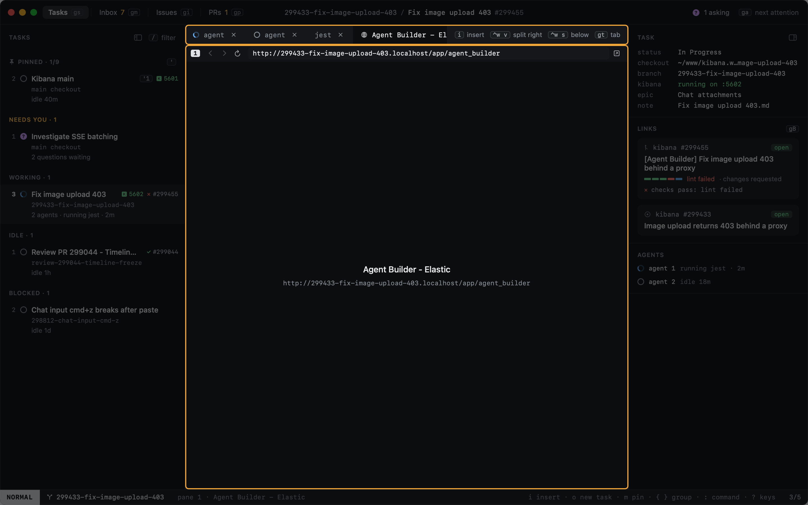
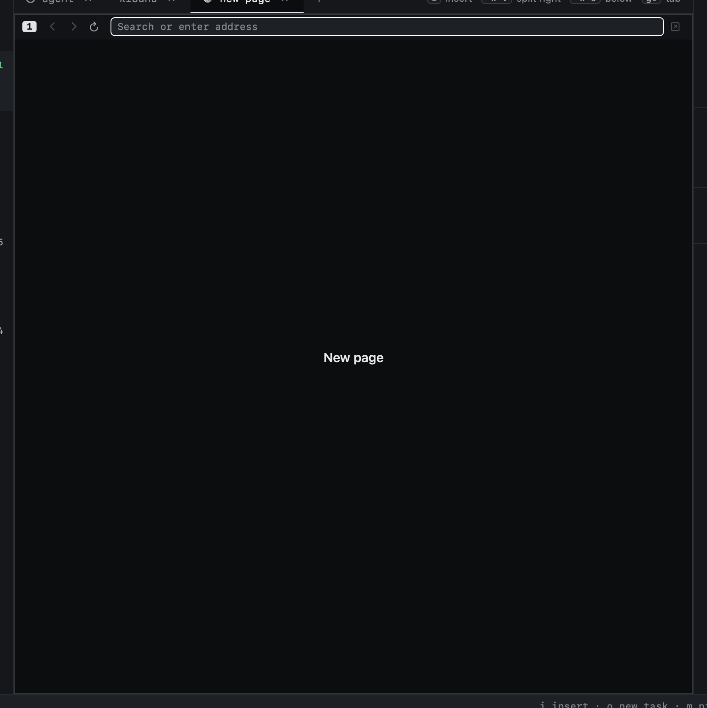
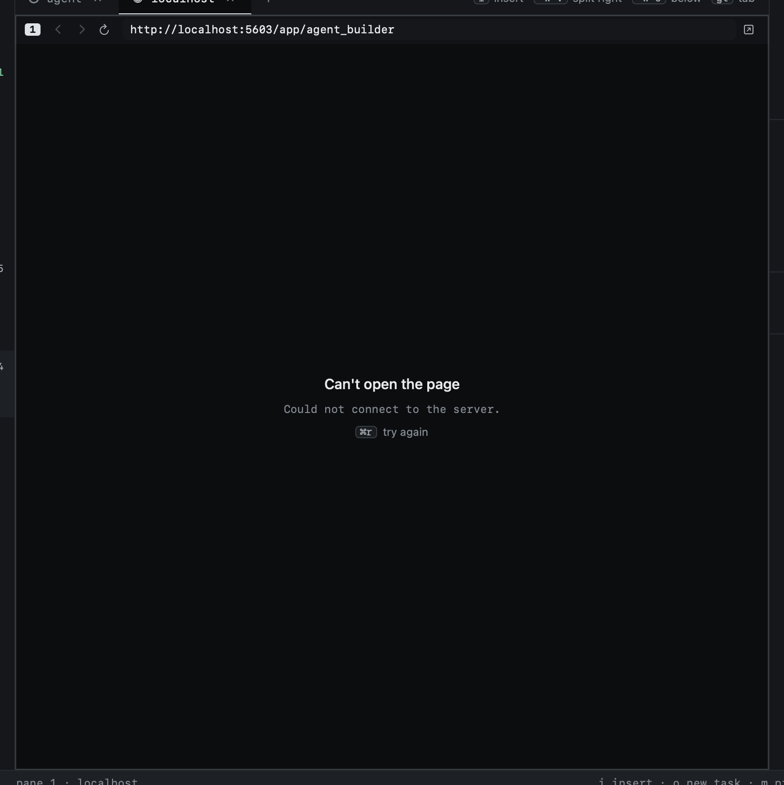

# Web pages

A task can hold web pages as well as terminals. A page is a tab or a split like any pane: it is saved with the task's
layout and closes with it. There is no separate browser window. Pages that aren't about one task go in the pinned
Kibana main task.

Pages are Safari's engine (WebKit), so a page looks and behaves as it does in Safari. A tab of pages has a globe glyph
and is named after the page's title, else its host.

## Opening a page

| Key | |
|---|---|
| `⌘T` | A new page in a new tab, the address field ready. Works from a terminal in INSERT too. |
| `:browser.new <address>` | A new page at that address |

In the address field, `↩` loads what you typed and hands the keys to the page; `⎋` leaves it. A full address stays as
typed. A bare host gets `http://` when it is local (`localhost`, `127.0.0.1`, anything under `.localhost`) and
`https://` otherwise. Anything that isn't an address searches Google.

After a relaunch, a saved page loads only when its tab is first shown.

## The toolbar

Back, forward, reload (a cross while loading, to stop), the address with a loading line under it, and on the right the
button that opens the page in your default browser. An error answer from the server (404, 500) shows its code beside
the address.

A page that can't be reached says why, with the key to try again.

## Keys

On a page, keys work as on a terminal: NORMAL is Heed's, INSERT is the page's. A click into a page enters INSERT;
`⇧⎋` goes back to NORMAL. Going to a page tab doesn't enter INSERT.

A browser's `⌘` chords work in both modes, also while you type in the page:

| Key | |
|---|---|
| `⌘L` | Edit the address |
| `⌘R` | Reload (stop while loading) |
| `⌘[` / `⌘]` | Back / forward (`⌘←` / `⌘→` too, outside a text field) |
| `⌘=` / `⌘-` | Zoom in / out (`:browser.zoom.reset` for actual size) |
| `⌘W` | Close the page, not the window |
| `:browser.external` | Open the page in your default browser |

Change them under `[keys.browser]` in config: single `⌘` or `⌃` chords only, since every other key is typed into the
page. See the [keyboard reference](../keyboard/reference.md).

## Links

Every link you open in Heed opens as a page inside Heed, and Heed shows it:

- a URL you `⌘`-click in a terminal or an agent's output: in that task, next to the tab you clicked in;
- `gB` and `gR`, the link picker, `⌘`-click on a link in the [inspector](inspector.md), and **Open a PR on GitHub**:
  in the task you are on;
- links in an issue's body in the [reader](../github/reading.md);
- `gB` in Inbox, Issues and PRs: in Kibana main.

Kibana main is the pinned task in the main checkout. Without one, links open in your default browser. Only web links
become pages: a file path or a `mailto:` link opens in the app macOS picks for it.

Inside a page, a click navigates in place. A `⌘`-click opens the link in a new tab behind; a link meant for a new
window opens a new tab and shows it. Links to other apps (`mailto:`, `zoommtg:`) open only when you click them, never
from the page on its own.

## Kibana opens by itself

Run `pk kbn` in a task's terminal and you don't get a Chrome tab. About 5 seconds after Kibana starts listening, Heed
opens a page on it as a new tab at the end of the task's tabs, in the background: the tab you are on doesn't change.
If the task already has a page on that Kibana (Kibana restarted), Heed reloads it instead of opening another.

The address is the one pk would have opened: `http://localhost` for the main checkout, `http://<worktree>.localhost`
for a worktree with its Caddy route, else `http://localhost:<port>`, each at Agent Builder. Heed sets `PK_BROWSER=heed`
in every terminal it starts, which is what keeps pk from opening Chrome; outside Heed, `pk kbn` opens Chrome as before.

A Kibana already running when Heed starts doesn't open a page. A page you closed comes back on the next start.

## Signing in

Sign in by hand, once per Kibana host: each worktree has its own host, so its own sign-in. Cookies are kept across
relaunches. Heed has no saved passwords or passkeys.

## Not yet

File uploads, downloads, JavaScript dialogs (`alert`, `confirm`), find in page, and camera, microphone or location
requests aren't handled yet. Pages with a self-signed certificate don't load, not even on `localhost`. For any of
these, open the page in your default browser from the toolbar.

Right-click a page and choose **Inspect Element** for Safari's Web Inspector.
