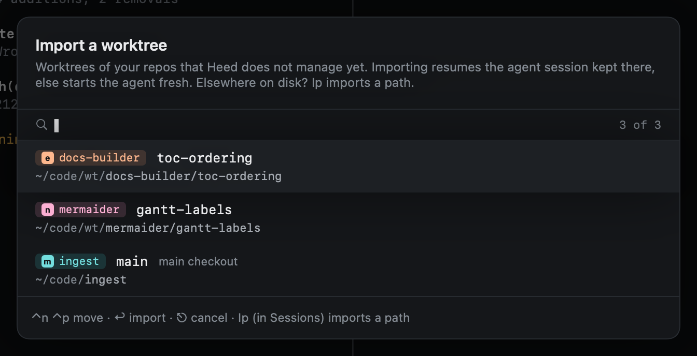
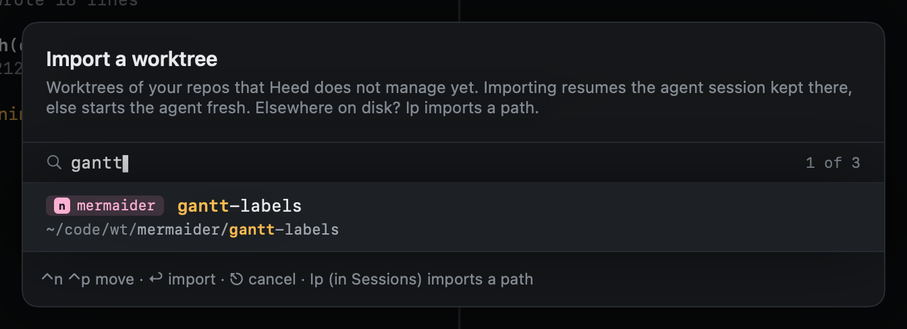
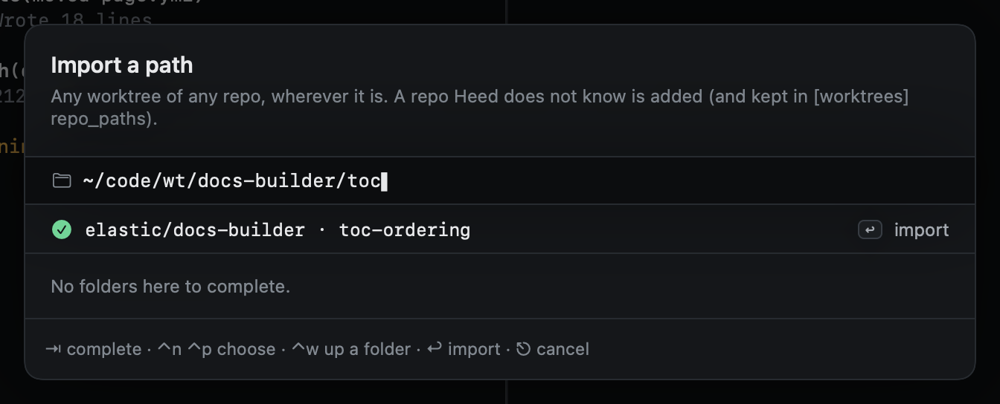

# Importing

Worktrees made outside Heed, where you may have run an agent yourself, can become sessions. Importing one resumes the
newest Claude Code session kept for that folder (its first prompt becomes the title), or starts claude
fresh. A confirmation says which before anything starts.

## A worktree Heed knows

`Iw` in Sessions lists the worktrees of your repos that have no session yet, main checkouts last. Type to filter by
repo, branch or the path below its root, `⌃n` `⌃p` to move, `↩` to import. In Repos, `↩` on a row does the same (`v`
and `o` for several).

## Any path

`Ip` in Sessions imports the worktree at a path, whatever repo it belongs to. `⇥` completes folders, `⌃w` goes up one,
and a preview says what is there. A repo Heed did not know is added, and kept in `repo_paths` when it lies outside your
scan roots. `:import <path>` does the same.

## What gets resumed

Only Claude Code keeps sessions where Heed can find them (`~/.claude/projects/<folder>/`). For other agents an import
starts the agent fresh in the worktree.
